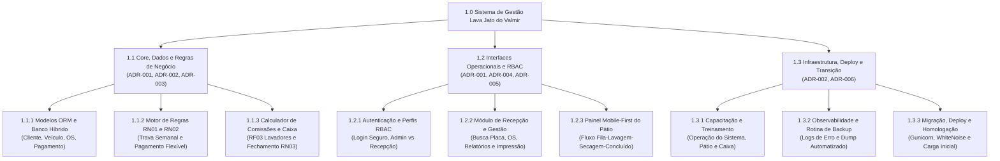
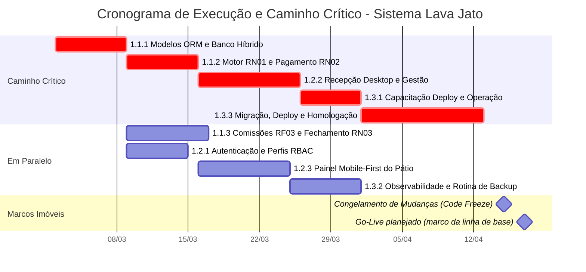

# Centro Universitário de Ensino Superior do Amazonas — CIESA
## Disciplina: Projetos de Sistemas (Etapa 2)
### Trabalho Individual: Do Projeto ao Plano de Projeto
**Como uma decisão de arquitetura vira escopo, cronograma, custo, risco e equipe**

* **Projeto:** Sistema de Gestão Operacional e Financeira — Lava Jato do Valmir
* **Autor:** Ednaldo Maciel da Silva
* **Artefato:** `PLANO.md` / `parte_dois.md` (Totalmente rastreável à Etapa 1: Requisitos, C4 Model v2.0 e Registros ADR-001 a ADR-006)
* **Data:** Novembro / 2026

> **Nota de escopo e status:** Este documento é uma linha de base acadêmica de planejamento. Datas de Go-Live, custos, reservas, hospedagem, backups, treinamento e demais entregas são premissas/estimativas do plano, não comprovação de que foram executadas ou de que o sistema esteja em produção. Para o estado do código, consulte [`docs/roadmap.md`](docs/roadmap.md).

---

## Visão Geral e Princípio Norteador

> *"Toda decisão de arquitetura é um cheque que o projeto assina. Arquiteto que não sabe o valor do cheque não está decidindo — está pedindo."*

O presente plano de projeto não introduz um sistema novo: ele converte as decisões arquiteturais da **Etapa 1** (especificadas na Arquitetura C4 Model e nos registros **ADR-001 a ADR-006**) em um plano de projeto formal, estruturado segundo os domínios de desempenho do **PMBOK 7ª Edição** (*Planejamento, Incerteza e Trabalho*).

Os pacotes de trabalho, prazos, custos e riscos deste plano buscam rastreabilidade às decisões arquiteturais da Etapa 1.

### Premissas Gerais do Projeto
1. **Regime de Trabalho:** Equipe de desenvolvimento ágil/acadêmica em dedicação parcial (~15 a 20 horas semanais de desenvolvimento e testes).
2. **Contexto Operacional e Localidade:** Operação física no pátio do *Lava Jato do Valmir*, Manaus/AM, sob fuso horário oficial `America/Manaus` (UTC-4).
3. **Premissa de Ambiente Tecnológico:** O plano considera PaaS/nuvem gerenciada em produção e SQLite3 em desenvolvimento; essa premissa não comprova uma implantação em produção.

---

## 1. A Tabela de Impacto — Seis Ângulos da Mesma Decisão

A tabela a seguir consolida as 6 decisões de arquitetura da Etapa 1 (**ADR-001 a ADR-006**), analisando cada uma sob as 6 dimensões de gestão: **Escopo, Cronograma, Custo, Riscos, Aquisições e Equipe**.

| Decisão Arquitetural (Etapa 1) | Escopo (Cria / Elimina) | Cronograma (Dependências e Caminho Crítico) | Custo (Implantação e 3 Anos de Operação) | Riscos (Mitiga / Cria / Resposta e Gatilho) | Aquisições (Construir vs. Comprar / Dependência) | Equipe (Competência e Operação Pós-Entrega) |
| :--- | :--- | :--- | :--- | :--- | :--- | :--- |
| **ADR-001: Padrão MVT com Framework Django (Python 3.11+)** | **Cria:** Core MVT, views operacionais, templates HTML/Tailwind, Django Admin nativo e testes unitários.  **Elimina:** Desenvolvimento e manutenção de SPA separada (React/Vue), backend REST isolado e pipeline de build Node.js. | **Dependências:** Modelos ORM antes das views e templates.  **Paralelismo:** Views de Recepção e Pátio avançam em paralelo após models estáveis.  **Caminho Crítico:** Sim. | **Implantação:** Custo de licença zero (código aberto).  **3 Anos:** Estimativa de custo de runtime Python. | **Mitiga:** Riscos de CSRF, XSS e SQLi por proteções do framework e consultas parametrizadas; isso não substitui configuração e revisão de segurança.  **Cria:** Acoplamento SSR em interações.  **Resposta:** Rotas curtas e testes de fluxo.  **Gatilho:** Latência > 2s em homologação. | **Construir:** Aplicação de domínio customizada.  **Comprar:** Nada.  **Dependência:** Framework Django mantido pela PSF; migração exigiria adaptação. | **Competência:** Domínio de Python/Django presente.  **Operação planejada:** Administrador e suporte técnico. |
| **ADR-002: Banco Híbrido (SQLite3 Dev / PostgreSQL Prod)** | **Cria:** Configuração `.env` / `dj-database-url` e migrações relacionais; backup é uma atividade operacional planejada, não automatizada pelo repositório.  **Elimina:** Obrigatoriedade de SGBD pesado ou Docker local para banca/avaliadores. | **Dependências:** Schema estabilizado antes da migração em nuvem.  **Paralelismo:** Provisionamento do PostgreSQL em paralelo ao dev local.  **Caminho Crítico:** Sim. | **Implantação:** R$ 0 no dev; setup em nuvem.  **3 Anos:** Estimativa de custo mensal de banco gerenciado (~R$ 60 a R$ 100/mês). | **Mitiga:** Concorrência e *database locked* no pátio.  **Cria:** Divergência de dialeto SQL entre SQLite e Postgres.  **Resposta:** Testar em homologação com PostgreSQL.  **Gatilho:** Erro em migração de homologação. | **Comprar:** Instância gerenciada de PostgreSQL.  **Dependência:** Padrão PostgreSQL (fácil portabilidade entre provedores). | **Competência:** Conhecimento relacional presente.  **Operação planejada:** Backup e monitoramento técnico a configurar. |
| **ADR-003: Regras de Negócio no Domínio/ORM (RN01, RN02, RF03)** | **Cria:** Método `pode_lavar_esta_semana()`, validação `clean()`, cálculo `valor_comissao` e modelo `Pagamento`.  **Elimina:** Duplicação de lógica de travas em views, formulários e scripts externos. | **Dependências:** Modelos antes das telas de recepção e pátio.  **Paralelismo:** Testes unitários das regras em paralelo ao CRUD.  **Caminho Crítico:** Sim. | **Implantação:** Esforço focado em testes unitários.  **3 Anos:** A regra semanal ajuda a evitar cobranças fora da política e o cálculo automatiza comissões. | **Mitiga:** Violação da trava semanal (RN01) e conflito de comissões (RF03).  **Cria:** Erros de borda na virada de semana (fuso local).  **Resposta:** Testes unitários com fuso de Manaus.  **Gatilho:** Falha de teste no domingo 23:59. | **Construir:** Regras específicas do negócio.  **Dependência:** Implementadas sobre o framework e ORM do Django. | **Competência:** Alinhada nas entrevistas de campo.  **Operação:** Validação pelo Administrador e uso pela Recepção. |
| **ADR-004: Interface Responsiva Tailwind (CDN) Mobile-First** | **Cria:** Templates herdados de `base.html`, painel desktop denso e painel pátio touch-friendly.  **Elimina:** Compilação Webpack/PostCSS e pasta `node_modules` no repositório. | **Dependências:** Endpoints e rotas definidos antes do CSS final.  **Paralelismo:** Layout do Pátio e da Recepção em paralelo.  **Caminho Crítico:** Não (parcialmente no aceite do pátio). | **Implantação:** Custo zero de ferramentas.  **3 Anos:** Depende apenas de conectividade no pátio. | **Mitiga:** Incompatibilidade com tablets e telas molhadas no pátio.  **Cria:** Indisponibilidade de CDN externa sem conexão.  **Resposta:** Teste de campo no pátio com 4G/Wi-Fi.  **Gatilho:** Reclamação de usabilidade/toque. | **Comprar:** Nada.  **Dependência:** CDN pública (Tailwind/FontAwesome). Migração para estático local é trivial. | **Competência:** Domínio pleno de HTML/CSS.  **Operação:** Lavadores (smartphone/tablet), Recepcionista (desktop). |
| **ADR-005: Controle RBAC Nativo (RN03 / RNF05)** | **Cria:** Grupos `Administrador` e `Recepcionista`, decorador `@user_passes_test(is_admin)` e login.  **Elimina:** Implementação caseira e vulnerável de tabelas de usuário e hash de senhas. | **Dependências:** Grupos antes do bloqueio das rotas financeiras.  **Paralelismo:** Telas operacionais e RBAC em paralelo.  **Caminho Crítico:** Sim. | **Implantação:** Esforço reduzido pela maturidade do Django.  **3 Anos:** Mitiga fraudes no caixa e alteração indevida de preços. | **Mitiga:** Recepcionista visualizando lucro ou alterando preços.  **Cria:** Erros 403 secos ou bloqueio acidental.  **Resposta:** Redirecionamento com mensagem flash.  **Gatilho:** Tentativa de acesso sem perfil adequado. | **Construir:** Configuração de permissões no `django.contrib.auth`.  **Dependência:** Nativo do framework. | **Competência:** Domínio nativo na equipe.  **Operação:** Seu Valmir administra acessos e perfis. |
| **ADR-006: Servidor Gunicorn + WhiteNoise** | **Prevê:** Configuração WSGI, `collectstatic` e variáveis de produção.  **Elimina:** Necessidade de Nginx reverso dedicado nesta configuração inicial e uso de `runserver` em produção. | **Dependências:** Sistema testado e variáveis configuradas antes de eventual deploy.  **Paralelismo:** Preparação do ambiente cloud em paralelo aos testes.  **Caminho Crítico:** Sim. | **Implantação:** Setup de deploy automatizado previsto.  **3 Anos:** Estimativa de custo mensal de runtime PaaS/VM (~R$ 50 a R$ 100/mês). | **Mitiga:** Insegurança do servidor de testes em produção.  **Cria:** Falha de deploy por variáveis (`ALLOWED_HOSTS`).  **Resposta:** Checklist formal de deploy e smoke tests.  **Gatilho:** Retorno HTTP 400/500 no ambiente de homologação. | **Comprar:** Hospedagem gerenciada compatível com WSGI.  **Dependência:** Facilidade de troca entre PaaS (Render, Railway, Fly.io). | **Competência:** Conhecimento de deploy WSGI/Linux.  **Operação planejada:** Monitoramento técnico de uptime e logs. |

---

## 2. Entregáveis da Etapa 2

### 2.1 Escopo — a EAP (Estrutura Analítica do Projeto)

A EAP decompõe a arquitetura do sistema em **3 níveis hierárquicos**, incorporando explicitamente os pacotes de transição (*capacitação, observabilidade, migração de dados*), além da identificação dos pacotes eliminados.

#### Pacotes Eliminados pela Arquitetura
1. **Compra de Servidor Físico Local Dedicado e No-break para o Posto:** Eliminado pela opção de hospedagem em nuvem gerenciada (ADR-002 e ADR-006), poupando investimento de capital (CAPEX) em infraestrutura física de alto risco de depreciação e manutenção em ambiente agressivo (água e sabão).
2. **Pipeline de Frontend Node.js / Webpack e Arquitetura SPA Separada:** Eliminado pela escolha de Django SSR + Tailwind CSS via CDN (ADR-001 e ADR-004), removendo dezenas de megabytes de dependências `node_modules` e simplificando o processo de build para zero ferramentas adicionais.
3. **Módulo Próprio de Criptografia de Senhas e Triggers SQL Customizadas:** Eliminado pelo uso do `django.contrib.auth` e centralização das regras de negócio no ORM do Django (ADR-003 e ADR-005).

#### Diagrama da EAP em Mermaid

#### Dicionário da EAP (Detalhamento dos Pacotes conforme Anexo A)

Os itens a seguir descrevem entregas e estimativas da linha de base do plano; não devem ser interpretados isoladamente como confirmação de conclusão. Consulte o roadmap para o estado conhecido da implementação.

* **Pacote 1.1.1 — Modelos ORM e Banco Híbrido:**
  * *Entrega:* Modelos de dados em `models.py` mapeando `Cliente`, `Veiculo`, `Lavador`, `Servico`, `OrdemServico`, `Pagamento` com suporte a SQLite3 local e PostgreSQL em produção via `dj-database-url`.
  * *Decisão-Origem:* ADR-001 e ADR-002.
  * *Responsável:* Ednaldo Maciel (Arquiteto/Desenvolvedor).
  * *Estimativa PERT:* 7,5 dias ($O=4, M=7, P=13$).
  * *Depende de:* Nenhum (pacote raiz de dados).
  * *Habilita:* 1.1.2, 1.1.3, 1.2.1.
* **Pacote 1.1.2 — Motor de Regras RN01 e RN02:**
  * *Entrega:* Método `pode_lavar_esta_semana()`, validação `clean()` de limite de 1 lavagem/semana para faturados e suporte a pagamentos na entrada ou saída (`PagamentoForm`).
  * *Decisão-Origem:* ADR-003.
  * *Responsável:* Ednaldo Maciel.
  * *Estimativa PERT:* 8,0 dias ($O=4, M=7, P=16$).
  * *Depende de:* 1.1.1.
  * *Habilita:* 1.2.2.
* **Pacote 1.1.3 — Calculador de Comissões e Caixa (RF03 / RN03):**
  * *Entrega:* Propriedade dinâmica `valor_comissao` na OS e algoritmos de consolidação financeira de fechamento diário e lucro líquido.
  * *Decisão-Origem:* ADR-003.
  * *Responsável:* Ednaldo Maciel.
  * *Estimativa PERT:* 8,5 dias ($O=4, M=8, P=15$).
  * *Depende de:* 1.1.1.
  * *Habilita:* 1.2.2.
* **Pacote 1.2.1 — Autenticação e Perfis RBAC (RNF01 / RNF05):**
  * *Entrega:* Tela de login unificada, hashes PBKDF2 e restrição de acesso via decorador `@user_passes_test(is_admin)` em views financeiras.
  * *Decisão-Origem:* ADR-005.
  * *Responsável:* Ednaldo Maciel.
  * *Estimativa PERT:* 6,5 dias ($O=3, M=6, P=12$).
  * *Depende de:* 1.1.1.
  * *Habilita:* 1.2.2.
* **Pacote 1.2.2 — Módulo de Recepção e Gestão:**
  * *Entrega planejada:* Interface de guarita com busca por placa, painel administrativo de fechamento diário e página imprimível; comprovante individual de OS não está implementado.
  * *Decisão-Origem:* ADR-001 e ADR-004.
  * *Responsável:* Ednaldo Maciel.
  * *Estimativa PERT:* 10,8 dias ($O=6, M=10, P=19$).
  * *Depende de:* 1.1.2, 1.1.3, 1.2.1.
  * *Habilita:* 1.3.1.
* **Pacote 1.2.3 — Painel Mobile-First do Pátio (RNF02):**
  * *Entrega:* Interface touch responsiva para lavadores acompanharem a fila e transicionarem estados de lavagem via smartphone/tablet.
  * *Decisão-Origem:* ADR-004.
  * *Responsável:* Ednaldo Maciel.
  * *Estimativa PERT:* 9,8 dias ($O=5, M=9, P=18$).
  * *Depende de:* 1.1.2.
  * *Habilita:* 1.3.1.
* **Pacote 1.3.1 — Capacitação e Treinamento (Transição):**
  * *Entrega:* Manual operacional ilustrado, sessão presencial de capacitação com Seu Valmir, recepcionista e lavadores de pátio.
  * *Decisão-Origem:* ADR-004 e ADR-005.
  * *Responsável:* Ednaldo Maciel e Seu Valmir.
  * *Estimativa PERT:* 6,5 dias ($O=3, M=6, P=12$).
  * *Depende de:* 1.2.2 e 1.2.3.
  * *Habilita:* 1.3.3.
* **Pacote 1.3.2 — Observabilidade e Rotina de Backup (Transição):**
  * *Entrega planejada:* Configuração de logs rotativos, alertas de falha HTTP 500 e script de backup PostgreSQL. Esses controles não são fornecidos pelo repositório atualmente.
  * *Decisão-Origem:* ADR-002 e ADR-006.
  * *Responsável:* Ednaldo Maciel.
  * *Estimativa PERT:* 7,7 dias ($O=4, M=7, P=14$).
  * *Depende de:* 1.2.3.
  * *Habilita:* 1.3.3.
* **Pacote 1.3.3 — Migração de Dados, Deploy e Homologação (Transição):**
  * *Entrega planejada:* Carga inicial de dados autorizados, deploy na nuvem com Gunicorn e WhiteNoise e teste ponta a ponta com a equipe. `popular_banco` cria dados fictícios e não deve ser usado em produção.
  * *Decisão-Origem:* ADR-002 e ADR-006.
  * *Responsável:* Ednaldo Maciel.
  * *Estimativa PERT:* 13,2 dias ($O=7, M=12, P=24$).
  * *Depende de:* 1.3.1 e 1.3.2.
  * *Habilita:* Marco Imóvel de Go-Live.

---

### 2.2 Cronograma, Dependências e Caminho Crítico

#### Premissas do Cronograma
* **Janela prevista na linha de base:** Início em 02/03/2026 e encerramento planejado com Go-Live em 17/04/2026; as datas são históricas do plano, não confirmação de implantação.
* **Cadência de Produção:** Trabalho concentrado com foco de 15 a 20 horas úteis por semana.
* **Marco planejado:** O plano previa Go-Live em 17/04/2026 e congelamento de código (*Code Freeze*) em 15/04/2026.

#### Justificativa Detalhada das Dependências ("Por Quê")

| Relação de Dependência | Por Quê a Arquitetura Impõe Esta Ordem |
| :--- | :--- |
| **1.1.1 (Modelos ORM) &rarr; 1.1.2 (Regras RN01/RN02)** | Não é possível validar regra semanal de frotas (`pode_lavar_esta_semana`) nem instanciar forma de pagamento sem as entidades `Veiculo`, `Cliente` e `Pagamento` estruturadas no ORM (ADR-001 e ADR-002). |
| **1.1.1 (Modelos ORM) &rarr; 1.1.3 (Comissões RF03)** | O cálculo de comissões depende da relação de chave estrangeira entre `OrdemServico`, `Servico` e a alíquota percentual cadastrada em `Lavador`. |
| **1.1.1 (Modelos ORM) &rarr; 1.2.1 (RBAC)** | As permissões de acesso dependem dos usuários e grupos vinculados aos registros operacionais. |
| **1.1.2 (Regras) + 1.2.1 (RBAC) &rarr; 1.2.2 (Recepção/Gestão)** | A interface da recepção e gestão financeira precisa renderizar alertas de bloqueio da RN01 e proteger rotas administrativas através do decorador `@user_passes_test(is_admin)`. Construir telas antes das regras geraria retrabalho estético. |
| **1.1.2 (Regras) &rarr; 1.2.3 (Painel Pátio)** | O avanço de etapas de pátio manipula diretamente o ciclo de vida do modelo `OrdemServico` (`FILA` &rarr; `LAVAGEM` &rarr; `SECAGEM` &rarr; `CONCLUIDO`). |
| **1.2.2 + 1.2.3 &rarr; 1.3.1 (Capacitação)** | Não se capacita o usuário final (Seu Valmir, recepcionista e lavadores) sem as interfaces completas e validadas funcionalmente. |
| **1.3.1 (Capacitação) + 1.3.2 (Observabilidade) &rarr; 1.3.3 (Deploy/Go-Live)** | Critério de prontidão previsto na linha de base: treinamento, monitoramento e backup precisam ser configurados e validados antes de eventual implantação; não estão todos implementados no repositório. |

#### Caminho Crítico e Paralelismo
* **Caminho Crítico:**  
  $$\text{1.1.1 Modelos ORM} \longrightarrow \text{1.1.2 Regras RN01/RN02} \longrightarrow \text{1.2.2 Recepção e Gestão} \longrightarrow \text{1.3.1 Capacitação} \longrightarrow \text{1.3.3 Migração e Deploy} \longrightarrow \text{Marco Imóvel}$$
* **Trabalho em Paralelo:**  
  * O pacote **1.1.3 (Comissões)** e **1.2.1 (RBAC)** avançam paralelamente a 1.1.2 após os modelos estarem prontos.
  * O pacote **1.2.3 (Painel Pátio Mobile)** avança em paralelo a 1.2.2.
  * O pacote **1.3.2 (Observabilidade e Backups)** é estruturado em paralelo à capacitação de usuários.

#### Diagrama de Gantt em Mermaid

---

### 2.3 Custo em Três Anos (Implantação e Operação)

> *"Implantar é o custo pequeno; operar é o grande. Comparar apenas a implantação é o erro clássico."*

#### Premissas de Custo
1. **Perfil da Aplicação:** Sistema web em Django com persistência relacional em PostgreSQL, com tráfego estimado de 50 a 100 requisições diárias (compatível com a volumetria do Lava Jato do Valmir).
2. **Desenvolvimento Inicial:** Esforço de projeto acadêmico/curricular sem custo de faturamento de mão de obra direta para o cliente; a implantação contempla setup, configuração de ambiente e carga de dados.
3. **Limite da Frente Orçamentária:** Teto máximo de **R$ 10.000,00** para o somatório em 3 anos e custeio anual limitado a **R$ 3.000,00/ano**.
4. **Comparação de Alternativas:**
   * **Alternativa A — Nuvem Gerenciada / PaaS Econômica (Web WSGI + PostgreSQL Gerenciado):** Instância gerenciada em provedor como Render, Railway ou Fly.io com SSL automático e backups gerenciados.
   * **Alternativa B — VPS Linux Dedicada (VM Autogerenciada + PostgreSQL Local):** Máquina virtual própria (ex.: Hetzner, DigitalOcean ou Linode) exigindo hardening manual do sistema operacional, manutenção de patches e scripts próprios de backup.

#### Tabela Comparativa de Custos em Três Anos

| Alternativa Analisada | Implantação (Setup, Configuração e Carga) | Custo Operacional Ano 1 | Custo Operacional Ano 2 | Custo Operacional Ano 3 | Custo Total em 3 Anos |
| :--- | :---: | :---: | :---: | :---: | :---: |
| **Alternativa A: Nuvem PaaS Gerenciada (Recomendada)** | R$ 600,00 *(setup variáveis, deploy contínuo, smoke tests)* | R$ 2.400,00 *(R$ 200/mês: app web, DB gerenciado, backups)* | R$ 2.400,00 *(R$ 200/mês)* | R$ 2.400,00 *(R$ 200/mês)* | **R$ 7.800,00** |
| **Alternativa B: VPS Linux Autogerenciada** | R$ 900,00 *(hardening SO, setup Gunicorn/PostgreSQL manual)* | R$ 1.800,00 *(R$ 150/mês: VM + storage backup offsite)* | R$ 1.800,00 *(R$ 150/mês)* | R$ 1.800,00 *(R$ 150/mês)* | **R$ 6.300,00** |

#### Análise e Decisão Econômica
Embora a **Alternativa B** aparente economia de R$ 1.500,00 em 3 anos na infraestrutura bruta, ela transfere um ônus severo de administração de sistemas para o proprietário ou suporte acadêmico (risco de parada por falta de atualizações de segurança ou quebra de banco local). A **Alternativa A** absorve a complexidade operacional com banco de dados gerenciado e alta disponibilidade, permanecendo plenamente dentro do limite orçamentário da frente (R$ 7.800,00 < R$ 10.000,00).

---

### 2.4 Estimativa dos Pacotes (PERT)

A estimativa utiliza o método dos três pontos segundo a distribuição Beta do PMBOK:

$$\text{PERT} = \frac{O + 4M + P}{6}, \qquad \text{Desvio Padrão} \approx \frac{P - O}{6}$$

* **O (Otimista):** Ambiente limpo, sem conflitos de requisitos ou bibliotecas, implementação flui de primeira.
* **M (Mais Provável):** Tempo padrão com refatorações normais e validações manuais.
* **P (Pessimista):** Incerteza arquitetural traduzida em dias (risco real de borda, fuso horário, quebra de layout mobile no pátio ou falha de deploy).

#### Tabela de Estimativa PERT com Rastreabilidade da Incerteza

| Pacote Principal da EAP | O (dias) | M (dias) | P (dias) | PERT (dias) | Desvio (dias) | Rastreabilidade da Cauda Pessimista à Arquitetura e Riscos |
| :--- | :---: | :---: | :---: | :---: | :---: | :--- |
| **1.1.1 Modelos ORM e Banco Híbrido** | 4 | 7 | 13 | **7,5** | 1,50 | Incompatibilidade de migrações ou tipos de campo entre SQLite3 e PostgreSQL (ADR-002). |
| **1.1.2 Motor RN01 e Pagamento RN02** | 4 | 7 | 16 | **8,0** | 2,00 | Casos de borda na trava semanal de frotas e virada de domingo para segunda sob `America/Manaus` (ADR-003). |
| **1.1.3 Comissões RF03 e Fechamento RN03** | 4 | 8 | 15 | **8,5** | 1,83 | Divergência em cálculos com centavos ou dízimas em rateios de comissões individuais (ADR-003). |
| **1.2.1 Autenticação e Perfis RBAC** | 3 | 6 | 12 | **6,5** | 1,50 | Ajuste fino de permissões e tratamento amigável de redirecionamento 403 para recepcionistas (ADR-005). |
| **1.2.2 Recepção Desktop e Gestão** | 6 | 10 | 19 | **10,8** | 2,17 | Refinamento de usabilidade na busca por placa em menos de 2s e diagramação do relatório para impressão A4 (ADR-001). |
| **1.2.3 Painel Mobile-First do Pátio** | 5 | 9 | 18 | **9,8** | 2,17 | Dificuldade de visualização sob sol e toque com tela úmida no pátio físico do posto (ADR-004). |
| **1.3.1 Capacitação Deploy e Operação** | 3 | 6 | 12 | **6,5** | 1,50 | Resistência cultural de colaboradores acostumados a usar fichas em papel e calculadoras analógicas. |
| **1.3.2 Observabilidade e Rotina de Backup** | 4 | 7 | 14 | **7,7** | 1,67 | Dificuldade em automatizar rotinas cron de dump e restauração segura do PostgreSQL na nuvem (ADR-006). |
| **1.3.3 Migração, Deploy e Homologação** | 7 | 12 | 24 | **13,2** | 2,83 | Falha de variáveis de ambiente (`ALLOWED_HOSTS`, `CSRF_TRUSTED_ORIGINS`) ou compressão WhiteNoise no deploy (ADR-006). |

---

### 2.5 Riscos, Gatilhos e Reservas

> *"Risco sem gatilho é lamento, não gestão."*

#### Definição das Reservas do Projeto
* **Reserva de Contingência (Linha de Base do Projeto):** Alocação de **6 dias de folga no cronograma** e **R$ 1.200,00** para absorver desvios dos riscos identificados durante o caminho crítico de desenvolvimento.
* **Reserva Gerencial (Sob Decisão da Direção/Patrocinador):** Alocação de **R$ 1.500,00** para imprevistos não mapeados (ex.: substituição emergencial de hardware do posto ou mudança mandatória de provedor cloud).

#### Matriz Formal de Riscos

| ID | Risco Identificado | Origem | Resposta Planejada | Gatilho Objetivo (Condição de Disparo) | Tipo de Reserva |
| :---: | :--- | :--- | :--- | :--- | :---: |
| **R01** | **Trava Semanal (RN01) falha ou bloqueia indevidamente frotas na virada de semana.** | Arquitetural (ADR-003) | **Mitigação planejada:** Usar `timezone.localtime()` com `America/Manaus` e manter testes de fronteira temporal em `tests.py`. | Detecção de erro em teste unitário de fronteira temporal ou reclamação de bloqueio indevido no primeiro teste de campo. | Contingência (Linha de Base) |
| **R02** | **Incompatibilidade de consultas ou erro de migração de SQLite3 para PostgreSQL.** | Arquitetural (ADR-002) | **Mitigar:** Executar suíte de homologação conectada diretamente a um banco PostgreSQL idêntico ao de produção antes do go-live. | Erro de migração (`psycopg2.OperationalError`) ou divergência de tipos em homologação. | Contingência (Linha de Base) |
| **R03** | **Layout quebrado ou lentidão de carregamento do Tailwind CSS via CDN no pátio.** | Arquitetural (ADR-004) | **Mitigar:** Testar o painel em smartphone real conectado via rede 4G local; se oscilar, embutir o CSS estático minificado no WhiteNoise. | Queda de formatação visual ou tempo de carregamento da página superior a 3 segundos no smartphone. | Contingência (Linha de Base) |
| **R04** | **Falha de deploy em produção por bloqueio de cabeçalhos CSRF ou ALLOWED_HOSTS.** | Projeto (ADR-006) | **Mitigar:** Executar checklist de deploy automatizado e manter arquivo de configuração documentado com rollback imediato. | Retorno de erro HTTP 400 (*Bad Request*) ou 403 (*CSRF verification failed*) no smoke test do ambiente staging. | Contingência (Linha de Base) |
| **R05** | **Sobrecarga de trabalho da equipe de desenvolvimento por compromissos acadêmicos.** | Equipe | **Mitigar:** Congelar mudanças de escopo 48 horas antes da virada e aplicar rigorosamente a Lei de Brooks (não adicionar novos membros). | Atraso acumulado superior a 4 dias úteis no pacote do caminho crítico na revisão semanal. | Gerencial (Direção) |
| **R06** | **Interrupção de serviço ou alteração brusca de preços no provedor PaaS na nuvem.** | Arquitetural / Projeto (ADR-006) | **Transferir/Mitigar:** Manter cópias de segurança do banco fora da nuvem principal e configuração desacoplada via variáveis `.env`. | Notificação formal de descontinuidade do serviço cloud ou indisponibilidade superior a 2 horas contínuas. | Gerencial (Direção) |

---

### 2.6 Aquisições (Construir vs. Comprar e Dependência de Fornecedor)

#### Decisão Construir vs. Comprar
* **Construir Internamente (Build):**
  * Toda a lógica de negócio do posto: cadastro de veículos, controle de fluxo de pátio por etapas, trava da RN01 para frotas conveniadas, cálculo automático de comissões por lavador (RF03) e telas de atendimento da guarita.
  * *Motivo:* Trata-se de um modelo de negócio altamente customizado à realidade do *Lava Jato do Valmir*. Softwares genéricos de mercado cobram mensalidades caras e não contemplam as especificidades da comissão diária informal e do limite semanal de lavagens.
* **Comprar / Assinar (Buy):**
  * Infraestrutura de nuvem gerenciada (hospedagem web WSGI e PostgreSQL gerenciado).
  * Componentes e bibliotecas consagradas de código aberto (Python, Django, Tailwind CSS, FontAwesome, Gunicorn, WhiteNoise).

#### Reflexão sobre Prazos Legais (A Lei nº 14.133/2021)
No contexto de contratações públicas regidas pela Nova Lei de Licitações (Lei nº 14.133/2021), a aquisição de tecnologia impõe etapas obrigatórias (Estudo Técnico Preliminar - ETP, Termo de Referência, Edital de Pregão Eletrônico e Fase Recursal) que consomem **no mínimo 90 a 120 dias corridos**. Como este projeto extensionista opera no âmbito de um empreendimento privado em cooperação acadêmica, a contratação da infraestrutura ocorre via contratação direta e imediata de serviços em nuvem (cartão de crédito/faturamento mensal em menos de 1 hora), eliminando qualquer risco de paralisia burocrática no cronograma.

#### Análise da Dependência de Fornecedor (*Vendor Lock-in*)
* **Justificativa da Dependência:** A escolha por um provedor PaaS (como Render ou Railway) com PostgreSQL gerenciado introduz dependência dos seus painéis de configuração e ciclo de deploy.
* **O que custaria sair (Tempo, Dinheiro e Reescrita):**
  * *Tempo de Migração:* **5 a 10 dias úteis** para provisionar nova VM ou outro provedor, configurar DNS e apontamentos de variáveis.
  * *Custo Financeiro de Saída:* Estimado em cerca de **R$ 150,00 a R$ 300,00** para sobreposição temporária de planos durante o período de transição.
  * *O que teria de ser reescrito:* A aplicação usa variáveis de ambiente e `DATABASE_URL`, o que reduz o acoplamento, mas a migração ainda exige adaptar e validar configuração, serviços, dados e deploy no provedor de destino.

---

### 2.7 Recursos Humanos e Governança Operacional

#### Leis da Engenharia de Software Aplicadas ao Projeto

1. **Lei de Brooks (*"Acrescentar gente a um projeto atrasado o atrasa mais"*):**
   * *Aplicação Prática no Plano:* Caso ocorra atraso nos pacotes de caminho crítico (como 1.2.2 ou 1.3.3), **a resposta jamais será convidar novos alunos ou desenvolvedores de fora**. O custo cognitivo de explicar a arquitetura, o padrão Django e as regras do negócio desviaria o tempo do desenvolvedor principal, piorando o atraso. Em caso de desvio, a resposta é a redução de escopo cosmético mantendo o foco nas regras centrais do MVP.
2. **Lei de Conway (*"A arquitetura reflete a comunicação da organização"*):**
   * *Aplicação Prática no Plano:* A separação física e funcional do posto entre **Guarita de Recepção** (atendimento rápido a clientes), **Pátio Molhado** (trabalho braçal dos lavadores) e **Escritório Administrativo** (gestão de caixa do Seu Valmir) traduziu-se rigorosamente na divisão modular da aplicação Django: módulo de recepção (`/recepcao/`), módulo de pátio mobile (`/patio/`) e módulo de gerenciamento restrito (`/gerenciamento/`).
3. **Capacitação (como pacote de trabalho planejado):**
   * O plano prevê capacitação dos colaboradores no **Pacote de Trabalho 1.3.1**, com 6,5 dias PERT estimados. A realização do treinamento precisa ser confirmada separadamente.

#### Matriz de Papéis: Quem Faz e Quem Opera Depois

| Papel / Ator | Responsabilidade na Construção / Implantação | Responsabilidade na Operação Contínua (Pós-Go-Live) |
| :--- | :--- | :--- |
| **Ednaldo Maciel da Silva** *(Arquiteto e Desenvolvedor)* | Responsabilidades previstas: projeto arquitetural, implementação, testes, preparação de deploy e treinamento. | Suporte, monitoramento, backups e manutenção são responsabilidades propostas, não serviços operacionais comprovados. |
| **Seu Valmir** *(Proprietário e Administrador)* | Elicitação das regras de negócio, validação da tabela de preços e comissões, homologação das telas e participação nos testes de aceitação. | Operador do painel administrativo (`/gerenciamento/`), responsável pelo fechamento de caixa diário, resolução de divergências, gestão de usuários/senhas e cobrança de frotas conveniadas. |
| **Recepcionista** *(Atendente da Guarita)* | Participação prevista em sessões de usabilidade da recepção e simulação de atendimento com clientes avulsos e faturados. | Uso previsto do módulo `/recepcao/`: busca por placa, cadastro e abertura de OS. Cliente avulso pode pagar no atendimento ou deixar pendente; faturados ficam pendentes para a empresa. Não há comprovante individual. |
| **Lavadores do Pátio** *(Equipe Operacional)* | Validação prevista do fluxo em dispositivos móveis e legibilidade dos controles. | Uso previsto do módulo `/patio/` via celular/tablet: acompanhar a fila e atualizar o status até `ENTREGUE`; a página mostra alterações mediante requisições HTTP, sem atualização push. |

---

## 3. Conclusão e Alinhamento com a Rubrica da Disciplina

O plano foi estruturado para abordar os critérios da rubrica de avaliação de **Projetos de Sistemas (CIESA)**; a nota ou validação formal depende da avaliação acadêmica:
* **EAP Rastreável (25%):** Todos os pacotes decorrem das decisões ADR-001 a ADR-006, contemplando 3 níveis de detalhamento e pacotes explícitos de transição e eliminação.
* **Cronograma e Caminho Crítico (20%):** Dependências tecnicamente justificadas com base na arquitetura, caminho crítico isolado, paralelismo e marcos imóveis declarados em diagrama de Gantt.
* **Custo em Três Anos (20%):** Comparação realista entre Nuvem PaaS e VPS Linux com cálculo completo de implantação e operação anualizada em 3 anos.
* **Estimativa PERT com Incerteza (10%):** Cálculo de três pontos para cada pacote principal, ancorando a cauda pessimista a riscos arquiteturais concretos.
* **Riscos com Gatilho e Reservas (15%):** 6 riscos catalogados com condições objetivas de disparo e separação formal entre reserva de contingência e gerencial.
* **Aquisições e Recursos Humanos (10%):** Análise da Lei 14.133/2021, justificativa de dependência e aplicação explícita das Leis de Brooks e Conway.
