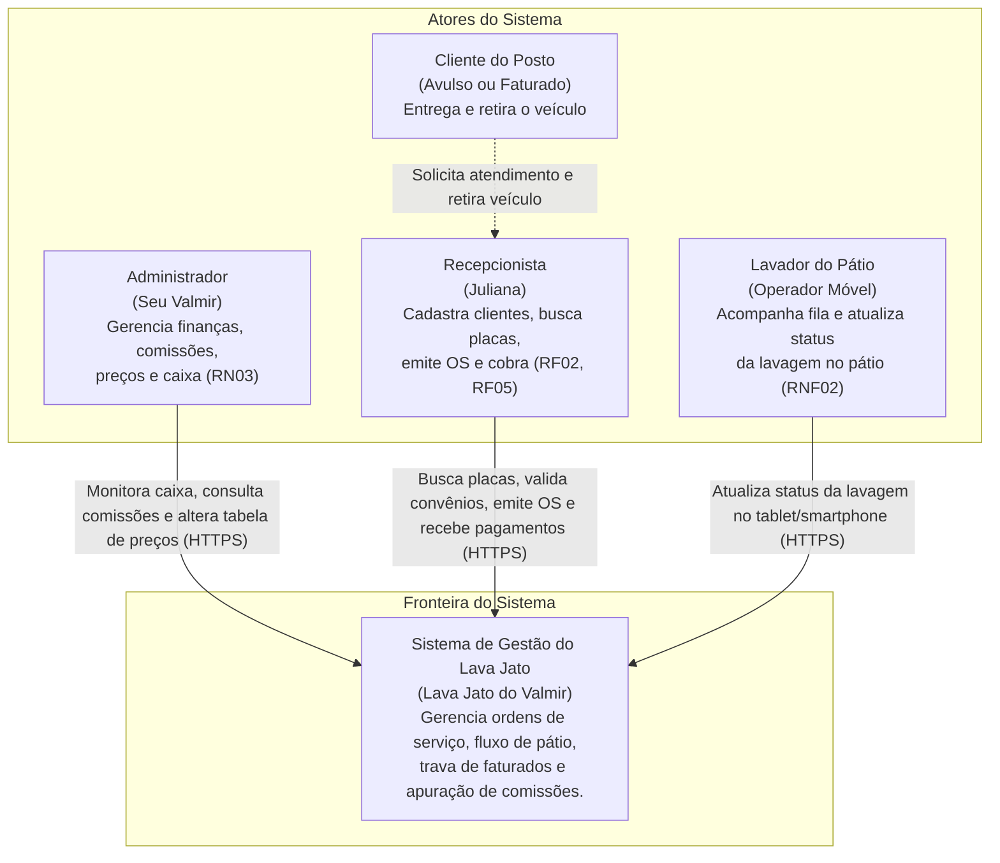
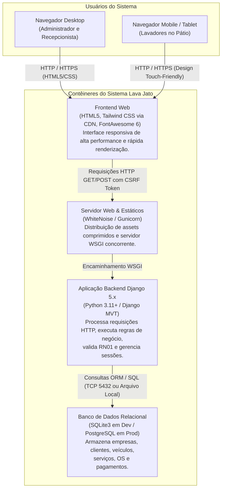
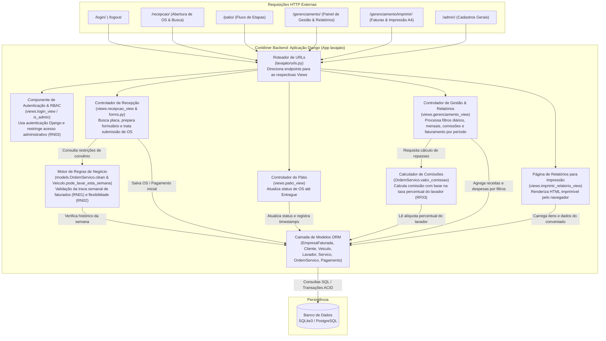

# 🏛️ Arquitetura de Software e Modelo C4 (Níveis 1 a 3)
## Sistema de Gestão Operacional e Financeira - Lava Jato do Valmir

* **Instituição:** Centro Universitário de Ensino Superior do Amazonas (CIESA) - Manaus/AM  
* **Curso:** Ciência da Computação  
* **Autor:** Ednaldo Maciel da Silva  
* **Data:** Novembro / 2026  
* **Versão:** 2.0 (Atualizado com a implementação Django e regras de negócio)  

---

## 1. Visão Geral e Fundamentação Arquitetural

A arquitetura do sistema **Lava Jato do Valmir** foi projetada para atender tanto à agilidade na recepção física do posto quanto à mobilidade dos lavadores no pátio e ao rigor no controle financeiro. A modelagem segue o framework **C4 Model** (desenvolvido por Simon Brown), permitindo uma visão hierárquica e progressiva da solução em múltiplos níveis de abstração:

1. **Nível 1 - Contexto do Sistema:** Os atores humanos (usuários) e os limites de fronteira do software com o ambiente externo.
2. **Nível 2 - Contêineres:** As aplicações executáveis, armazenamento de dados e protocolos de comunicação que compõem o sistema.
3. **Nível 3 - Componentes:** A organização interna do contêiner backend em Django, detalhando como os controladores, formulários, validadores de regras de negócio e camada ORM interagem.

---

## 2. Matriz de Rastreabilidade com Regras de Negócio e Requisitos

| Requisito / Regra | Descrição no Negócio | Camada de Implementação C4 |
| :--- | :--- | :--- |
| **RN01** | Limite estrito de 1 lavagem/semana para frotas conveniadas/faturadas com bloqueio automático. | Nível 3: `Motor de Regras de Negócio (models.clean & pode_lavar_esta_semana)` |
| **RN02** | Cliente avulso pode pagar na entrada ou depois; cliente faturado é lançado à empresa vinculada sem pagamento no atendimento. | Nível 3: fluxo de pagamento da recepção e relatório por `EmpresaFaturada` |
| **RN03** | Fechamento de caixa, alteração de tabela e ajuste de divergências restritos ao Administrador. | Nível 3: `Controle de Acesso RBAC (@user_passes_test(is_admin))` |
| **RF01 / RNF05** | Gerenciar usuários e controle de acesso baseado em perfis (Admin vs Recepcionista). | Nível 3: `Controlador de Autenticação (django.contrib.auth)` |
| **RF02** | Cadastro de veículos, clientes e empresas faturadas. | Nível 3: `Controlador de Recepção & Camada ORM (EmpresaFaturada, Veiculo & Cliente)` |
| **RF03** | Gestão de lavadores e cálculo automático da comissão por serviço executado. | Nível 3: `Módulo Financeiro & Calculador de Comissões (valor_comissao)` |
| **RF05 / RNF02** | Acompanhamento do pátio por requisições HTTP e interface responsiva para dispositivos móveis. | Nível 2 & 3: `Frontend Responsivo (Tailwind) & Controlador de Pátio` |
| **RF06 / RF08** | Pagamentos avulsos, faturamento corporativo, relatórios operacionais e demonstrativo imprimível. Comprovante individual de OS não implementado. | Nível 3: `Controlador de Gestão, Relatórios e Emissor de Faturas Impressas` |

---

## 3. Nível 1: Diagrama de Contexto de Sistema (System Context)

O diagrama de contexto estabelece as fronteiras do sistema, identificando os diferentes perfis de usuários e como eles interagem com a solução.



Os meios PIX, dinheiro e cartão são selecionados e registrados pela operação; não há integração técnica com gateway ou instituição financeira.

### Detalhamento dos Elementos de Contexto
* **Administrador (Seu Valmir):** Acessa o dashboard restrito (`/gerenciamento/`) e o Django Admin (`/admin/`), monitorando faturamento diário, extrato de comissões a pagar e relatórios de auditoria (**RF08, RN03**).
* **Recepcionista:** Opera a estação desktop da guarita (`/recepcao/`), busca placas, abre OS e registra pagamentos de clientes avulsos. Clientes faturados não pagam no atendimento; o valor fica pendente para a empresa vinculada.
* **Operador do pátio:** Um usuário autenticado acessa `/patio/` para transicionar veículos por *Fila*, *Lavagem*, *Secagem*, *Concluído* e *Entregue*. O código não define grupo específico de lavador.
* **Cliente:** Beneficiário do serviço de limpeza automotiva, podendo ser **Avulso** (sem limite semanal) ou **Faturado** (sujeito à trava de 1 lavagem semanal da **RN01**).

---

## 4. Nível 2: Diagrama de Contêineres (Container Diagram)

O diagrama de contêineres detalha as unidades de execução do software, seus papéis de processamento, linguagens e tecnologias adotadas.



### Especificação dos Contêineres
1. **Frontend Web (HTML5 / Tailwind CSS):**
   * *Função:* Apresentação visual, formulários interativos, badges de status e alertas coloridos para bloqueios de negócio. Não há atualização push/WebSocket.
   * *Protocolos:* Renderizado via Server-Side Rendering (SSR) pelo Django Template Engine com dependências de estilo carregadas via CDN.
2. **Servidor Web e Gestão de Estáticos (WhiteNoise / Gunicorn):**
   * *Função:* Fornecimento de arquivos estáticos pelo WhiteNoise; quantidade e tipo de workers dependem do comando de inicialização configurado.
3. **Aplicação Backend (Django):**
   * *Função:* Núcleo de regras de negócio, autenticação baseada em sessão segura, roteamento MVT e transações relacionais.
4. **Banco de Dados Relacional:**
   * *Desenvolvimento:* SQLite3 embarcado em `backend/db.sqlite3` para zero dependência externa.
   * *Produção:* PostgreSQL configurado via `DATABASE_URL`. O repositório não implementa backup automatizado; esse controle precisa ser configurado e validado no ambiente.

---

## 5. Nível 3: Diagrama de Componentes (Component Diagram - Backend Django)

O diagrama de componentes decompõe a aplicação web Django (especificamente o app `lavajato` e módulos do `config`), detalhando como cada classe e módulo implementa as regras do negócio.



### Detalhamento dos Componentes Internos

#### 1. Roteador de URLs (`lavajato/urls.py`)
Mapeia os caminhos canônicos (`/login/`, `/recepcao/`, `/patio/`, `/gerenciamento/`, `/os/<id>/pagar/`) para os respectivos manipuladores de view, garantindo separação declarativa de rotas.

#### 2. Controlador de Autenticação e RBAC (`views.login_view` e `is_admin`)
* **Implementação dos requisitos:** **RF01**, **RN03**, **RNF01**, **RNF05**.
* Usa o sistema de autenticação e hash de senhas padrão do Django.
* Protege a visão administrativa (`/gerenciamento/`) através do decorador `@user_passes_test(is_admin)`, impedindo o acesso de operadores não autorizados aos dados de faturamento e fechamento de caixa.

#### 3. Controlador de Recepção (`views.recepcao_view` & `forms.OrdemServicoForm`)
* **Implementação dos requisitos:** **RF02**, **RF05**, **RN01**, **RN02**.
* Recebe consultas por placa de veículo, normaliza o formato (removendo hifens e aplicando uppercase) e invoca a validação de limite semanal de faturamento.
* Se a placa pertencer a um cliente `FATURADO` e já possuir atendimento registrado na semana corrente, renderiza feedback de alerta na tela e impede a persistência.
* Para clientes avulsos, permite marcar pagamento imediato ou deixá-lo pendente para recebimento posterior. Para clientes faturados, esconde a opção de pagamento no atendimento e cria um lançamento `FATURADO` pendente para a empresa vinculada.

#### 4. Motor de Regras de Negócio (`clean()` e `pode_lavar_esta_semana()`)
* **Implementação da regra central:** **RN01**.
* Localizado no modelo [`Veiculo`](../backend/lavajato/models.py) e no método `clean()` de [`OrdemServico`](../backend/lavajato/models.py):
  $$\text{início\_semana} = \text{hoje} - \text{dias}(\text{dia\_da\_semana})$$
* Verifica se existe alguma `OrdemServico` associada ao veículo desde o início da semana. Caso afirmativo, lança `ValidationError`. `OrdemServico.save()` chama `full_clean()` antes de salvar; operações em lote que não chamam `save()` não executam essa validação.

#### 5. Controlador de Pátio (`views.patio_view`)
* **Implementação dos requisitos:** **RF05**, **RNF02**.
* Projetado para consumo móvel no pátio físico. Permite atualizar o ciclo de vida do veículo por requisições HTTP:
  $$\text{FILA} \longrightarrow \text{LAVAGEM} \longrightarrow \text{SECAGEM} \longrightarrow \text{CONCLUIDO} \longrightarrow \text{ENTREGUE}$$
* `CONCLUIDO` indica que o serviço está pronto; a coluna final do quadro registra a entrega. Ao mudar para `ENTREGUE`, o sistema grava `data_hora_saida`. A entrega física não depende de o pagamento estar concluído.

#### 6. Módulo de Gestão Financeira, Relatórios e Emissão de Faturas (`views.gerenciamento_view`, `views.imprimir_relatorio_view`)
* **Implementação dos requisitos:** **RF03**, **RF08**, **RN03**.
* O módulo gerencial do sistema é estruturado em quatro categorias especializadas de relatório:
  1. **Fechamento Diário:** Permite filtrar qualquer dia do calendário, apurando faturamento bruto, volume de lavagens, repasses de comissão e lucro líquido do dia.
  2. **Consolidado Mensal:** Agrega receitas e despesas por mês e ano, calculando ticket médio por veículo e distribuição das formas de pagamento.
  3. **Extrato de Comissões por Lavador:** Filtra por período e lavador específico, calculando:
     $$\text{Comissão} = \text{Valor da OS} \times \left(\frac{\text{Percentual do Lavador}}{100}\right)$$
  4. **Faturamento de Empresas Conveniadas:** Permite selecionar `EmpresaFaturada` e período, somando as OSs dos clientes vinculados e exibindo o saldo pendente.
* **Componente de Impressão (`imprimir_relatorio_view`):** Renderiza HTML preparado para impressão/salvamento em PDF pelo navegador. Os dados do estabelecimento e bancários no código são valores de exemplo e precisam ser conferidos/substituídos antes de enviar o documento como cobrança real.

#### 7. Camada ORM (`models.py`)
Mapeia as 7 entidades do app (`EmpresaFaturada`, `Cliente`, `Veiculo`, `Lavador`, `Servico`, `OrdemServico`, `Pagamento`), com ações de exclusão definidas por `on_delete` em cada relação.

---

## 6. Padrão Arquitetural Adotado: MVT (Model-View-Template)

O Django estrutura a separação de responsabilidades pelo padrão **MVT**, correlato ao clássico MVC (Model-View-Controller):

```text
┌─────────────────┐       Requisição HTTP       ┌─────────────────┐
│     Cliente     │ ──────────────────────────► │    urls.py      │
│  (Navegador UI) │ ◄────────────────────────── │  (Roteamento)   │
└─────────────────┘       Resposta HTML/CSS     └────────┬────────┘
         ▲                                               │
         │ Renderiza                                     ▼
┌────────┴────────┐       Preenche Contexto     ┌─────────────────┐
│    Template     │ ◄────────────────────────── │    views.py     │
│ (Tailwind HTML) │                             │   (Controller)  │
└─────────────────┘                             └────────┬────────┘
                                                         │
                                      Consulta / Atualiza│
                                                         ▼
                                                ┌─────────────────┐
                                                │    models.py    │
                                                │   (ORM Domain)  │
                                                └────────┬────────┘
                                                         │
                                        SQL / Persistência│
                                                         ▼
                                                ┌─────────────────┐
                                                │ Banco de Dados  │
                                                │(SQLite/Postgres)│
                                                └─────────────────┘
```

---

## 7. Requisitos Não Funcionais (RNF) e Atributos de Qualidade

1. **Segurança (RNF01 e RNF05):**
   * Senhas armazenadas pelos hashers e parâmetros configurados pelo Django; o projeto não fixa uma contagem de iterações própria.
   * Tokens CSRF (*Cross-Site Request Forgery*) obrigatórios em todos os formulários POST.
   * Proteção de cabeçalhos HTTP via `SecurityMiddleware` e `X-Frame-Options` ativado contra clickjacking.
2. **Usabilidade e Responsividade (RNF02):**
   * Layout responsivo utilizando Tailwind CSS, com componentes táteis específicos para lavadores no pátio e visualização densa em grade para operadores de recepção.
3. **Desempenho e Latência (RNF03):**
   * `placa` é única e chaves estrangeiras recebem índices do Django; não há índices explícitos documentados para `data_hora` e `status`, nem medição de desempenho.
   * Algumas consultas usam `select_related`; a aplicação não comprova eliminação geral de consultas $N+1$.
4. **Confiabilidade e Backup (RNF04):**
   * Configuração por variáveis de ambiente; backup automatizado de PostgreSQL não está implementado no repositório e deve ser configurado no ambiente.

