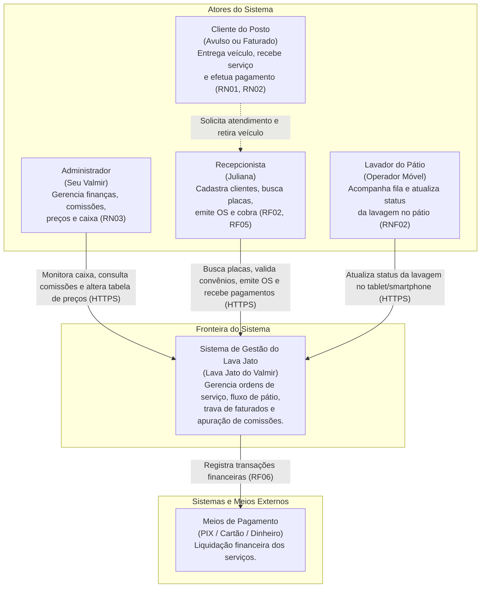
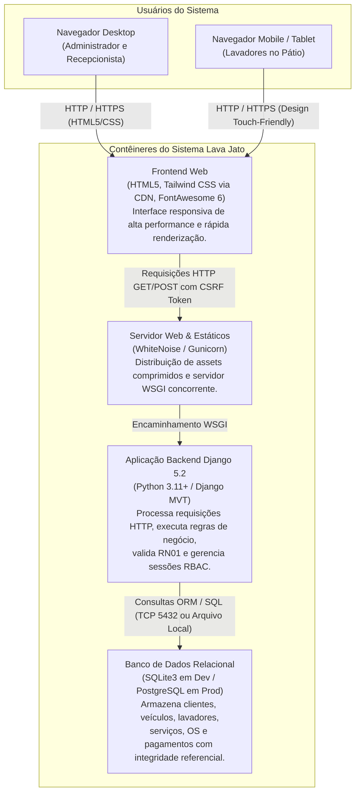
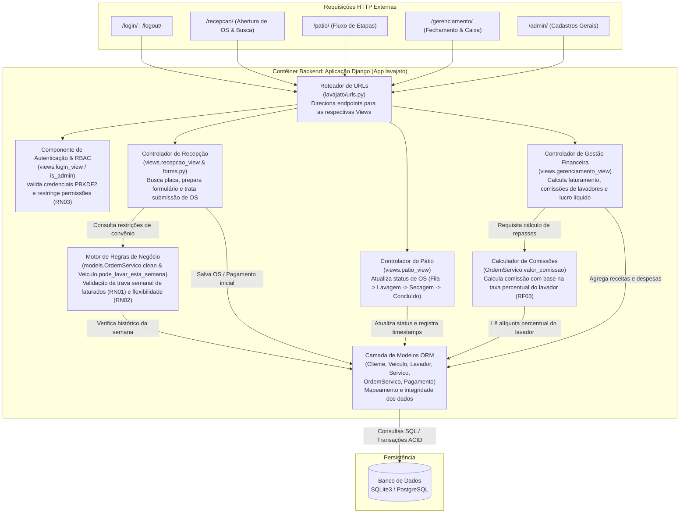

# 🏛️ Arquitetura de Software e Modelo C4 (Níveis 1 a 3)
## Sistema de Gestão Operacional e Financeira - Lava Jato do Valmir

* **Instituição:** Centro Universitário de Ensino Superior do Amazonas (CIESA) - Manaus/AM  
* **Curso:** Ciência da Computação  
* **Autor:** Ednaldo Maciel da Silva  
* **Data:** Novembro / 2026  
* **Versão:** 2.0 (Atualizado com a implementação Django e regras de negócio)  

---

## 1. Visão Geral e Fundamentação Arquitetural

A arquitetura do sistema **Lava Jato do Valmir** foi projetada para atender tanto à agilidade na recepção física do posto quanto à mobilidade dos lavadores no pátio e ao rigor no controle financeiro. A modelagem segue o framework **C4 Model** (desenvolvido por Simon Brown), permitindo uma visão hierárquica e progressiva da solução em múltiplos níveis de abstração:

1. **Nível 1 - Contexto do Sistema:** Os atores humanos (usuários) e os limites de fronteira do software com o ambiente externo.
2. **Nível 2 - Contêineres:** As aplicações executáveis, armazenamento de dados e protocolos de comunicação que compõem o sistema.
3. **Nível 3 - Componentes:** A organização interna do contêiner backend em Django, detalhando como os controladores, formulários, validadores de regras de negócio e camada ORM interagem.

---

## 2. Matriz de Rastreabilidade com Regras de Negócio e Requisitos

| Requisito / Regra | Descrição no Negócio | Camada de Implementação C4 |
| :--- | :--- | :--- |
| **RN01** | Limite estrito de 1 lavagem/semana para frotas conveniadas/faturadas com bloqueio automático. | Nível 3: `Motor de Regras de Negócio (models.clean & pode_lavar_esta_semana)` |
| **RN02** | Flexibilidade para pagamento no momento da entrada ou na retirada do veículo. | Nível 3: `Módulo de Caixa & Pagamento (PagamentoForm & Pagamento Model)` |
| **RN03** | Fechamento de caixa, alteração de tabela e ajuste de divergências restritos ao Administrador. | Nível 3: `Controle de Acesso RBAC (@user_passes_test(is_admin))` |
| **RF01 / RNF05** | Gerenciar usuários e controle de acesso baseado em perfis (Admin vs Recepcionista). | Nível 3: `Controlador de Autenticação (django.contrib.auth)` |
| **RF02** | Cadastro e controle de veículos, placas e segmentação de clientes (Avulso vs Faturado). | Nível 3: `Controlador de Recepção & Camada ORM (Veiculo & Cliente)` |
| **RF03** | Gestão de lavadores e cálculo automático da comissão por serviço executado. | Nível 3: `Módulo Financeiro & Calculador de Comissões (valor_comissao)` |
| **RF05 / RNF02** | Acompanhamento do pátio em tempo real e interface responsiva mobile/tablet. | Nível 2 & 3: `Frontend Mobile-First (Tailwind) & Controlador de Pátio` |
| **RF06 / RF08** | Emissão de OS, comprovantes, fechamento de caixa diário e relatórios operacionais. | Nível 3: `Controlador de Gestão e Dashboard Financeiro` |

---

## 3. Nível 1: Diagrama de Contexto de Sistema (System Context)

O diagrama de contexto estabelece as fronteiras do sistema, identificando os diferentes perfis de usuários e como eles interagem com a solução.



### Detalhamento dos Elementos de Contexto
* **Administrador (Seu Valmir):** Acessa o dashboard restrito (`/gerenciamento/`) e o Django Admin (`/admin/`), monitorando faturamento diário, extrato de comissões a pagar e relatórios de auditoria (**RF08, RN03**).
* **Recepcionista:** Opera a estação desktop da guarita (`/recepcao/`), realizando busca rápida por placa, abrindo Ordens de Serviço e executando cobranças na entrada ou saída (**RF05, RN02**).
* **Lavador:** Acessa a interface responsiva de pátio (`/patio/`) via dispositivos móveis para transicionar veículos entre *Fila*, *Lavagem*, *Secagem* e *Concluído* (**RF03, RNF02**).
* **Cliente:** Beneficiário do serviço de limpeza automotiva, podendo ser cliente **Avulso** (sem limite semanal) ou **Faturado** (sujeito à trava estrita de 1 lavagem semanal da **RN01**).

---

## 4. Nível 2: Diagrama de Contêineres (Container Diagram)

O diagrama de contêineres detalha as unidades de execução do software, seus papéis de processamento, linguagens e tecnologias adotadas.



### Especificação dos Contêineres
1. **Frontend Web (HTML5 / Tailwind CSS):**
   * *Função:* Apresentação visual, formulários interativos, badges de status em tempo real e alertas coloridos para bloqueios de negócio.
   * *Protocolos:* Renderizado via Server-Side Rendering (SSR) pelo Django Template Engine com dependências de estilo carregadas via CDN.
2. **Servidor Web e Gestão de Estáticos (WhiteNoise / Gunicorn):**
   * *Função:* Fornecimento de assets estáticos com compressão Gzip/Brotli e suporte a múltiplos workers assíncronos em ambiente de produção (Linux).
3. **Aplicação Backend (Django):**
   * *Função:* Núcleo de regras de negócio, autenticação baseada em sessão segura, roteamento MVT e transações relacionais.
4. **Banco de Dados Relacional:**
   * *Desenvolvimento:* SQLite3 embarcado em `backend/db.sqlite3` para zero dependência externa.
   * *Produção:* PostgreSQL configurado via `DATABASE_URL` para suporte a alta concorrência e backups automatizados (**RNF04**).

---

## 5. Nível 3: Diagrama de Componentes (Component Diagram - Backend Django)

O diagrama de componentes decompõe a aplicação web Django (especificamente o app `lavajato` e módulos do `config`), detalhando como cada classe e módulo implementa as regras do negócio.



### Detalhamento dos Componentes Internos

#### 1. Roteador de URLs (`lavajato/urls.py`)
Mapeia os caminhos canônicos (`/login/`, `/recepcao/`, `/patio/`, `/gerenciamento/`, `/os/<id>/pagar/`) para os respectivos manipuladores de view, garantindo separação declarativa de rotas.

#### 2. Controlador de Autenticação e RBAC (`views.login_view` e `is_admin`)
* **Implementação dos requisitos:** **RF01**, **RN03**, **RNF01**, **RNF05**.
* Realiza autenticação criptografada de senhas via PBKDF2 com salt SHA256.
* Protege a visão administrativa (`/gerenciamento/`) através do decorador `@user_passes_test(is_admin)`, impedindo o acesso de operadores não autorizados aos dados de faturamento e fechamento de caixa.

#### 3. Controlador de Recepção (`views.recepcao_view` & `forms.OrdemServicoForm`)
* **Implementação dos requisitos:** **RF02**, **RF05**, **RN01**, **RN02**.
* Recebe consultas por placa de veículo, normaliza o formato (removendo hifens e aplicando uppercase) e invoca a validação de limite semanal de faturamento.
* Se a placa pertencer a um cliente `FATURADO` e já possuir atendimento registrado na semana corrente, renderiza feedback de alerta na tela e impede a persistência.
* Oferece a seleção flexível de pagamento imediato (**RN02** na Entrada) ou posterior (**RN02** na Retirada).

#### 4. Motor de Regras de Negócio (`clean()` e `pode_lavar_esta_semana()`)
* **Implementação da regra central:** **RN01**.
* Localizado no coração do modelo [`Veiculo`](file:///c:/Users/Ednaldo%20Maciel/projeto_posto_de_lavagem_ciesa/backend/lavajato/models.py) e [`OrdemServico`](file:///c:/Users/Ednaldo%20Maciel/projeto_posto_de_lavagem_ciesa/backend/lavajato/models.py):
  $$\text{início\_semana} = \text{hoje} - \text{dias}(\text{dia\_da\_semana})$$
* Verifica se existe alguma `OrdemServico` associada ao veículo com `data_hora >= início_semana`. Caso afirmativo, lança `ValidationError`, blindando o sistema contra inconsistências.

#### 5. Controlador de Pátio (`views.patio_view`)
* **Implementação dos requisitos:** **RF05**, **RNF02**.
* Projetado para consumo móvel no pátio físico. Permite aos lavadores alterar o ciclo de vida do veículo em tempo real:
  $$\text{FILA} \longrightarrow \text{LAVAGEM} \longrightarrow \text{SECAGEM} \longrightarrow \text{CONCLUIDO}$$
* Ao atingir o status `CONCLUIDO`, registra o timestamp `data_hora_saida` e disponibiliza a OS para entrega imediata na recepção.

#### 6. Módulo Financeiro e Calculador de Comissões (`views.gerenciamento_view` e `valor_comissao`)
* **Implementação dos requisitos:** **RF03**, **RF08**, **RN03**.
* O cálculo da comissão individual de cada lavador é dinâmico:
  $$\text{Comissão} = \text{Valor Total da OS} \times \left(\frac{\text{Percentual do Lavador}}{100}\right)$$
* Agrega o faturamento total diário, calcula o total de comissões acumuladas e apura o lucro líquido operacional do dia:
  $$\text{Lucro Líquido} = \text{Faturamento Diário} - \sum \text{Comissões}$$

#### 7. Camada ORM (`models.py`)
Mapeia as 6 entidades fundamentais do banco de dados relacional (`Cliente`, `Veiculo`, `Lavador`, `Servico`, `OrdemServico`, `Pagamento`), assegurando integridade referencial com chaves estrangeiras com regras `PROTECT` e `CASCADE` apropriadas.

---

## 6. Padrão Arquitetural Adotado: MVT (Model-View-Template)

O Django estrutura a separação de responsabilidades pelo padrão **MVT**, correlato ao clássico MVC (Model-View-Controller):

```text
┌─────────────────┐       Requisição HTTP       ┌─────────────────┐
│     Cliente     │ ──────────────────────────► │    urls.py      │
│  (Navegador UI) │ ◄────────────────────────── │  (Roteamento)   │
└─────────────────┘       Resposta HTML/CSS     └────────┬────────┘
         ▲                                               │
         │ Renderiza                                     ▼
┌────────┴────────┐       Preenche Contexto     ┌─────────────────┐
│    Template     │ ◄────────────────────────── │    views.py     │
│ (Tailwind HTML) │                             │   (Controller)  │
└─────────────────┘                             └────────┬────────┘
                                                         │
                                      Consulta / Atualiza│
                                                         ▼
                                                ┌─────────────────┐
                                                │    models.py    │
                                                │   (ORM Domain)  │
                                                └────────┬────────┘
                                                         │
                                        SQL / Persistência│
                                                         ▼
                                                ┌─────────────────┐
                                                │ Banco de Dados  │
                                                │(SQLite/Postgres)│
                                                └─────────────────┘
```

---

## 7. Requisitos Não Funcionais (RNF) e Atributos de Qualidade

1. **Segurança (RNF01 e RNF05):**
   * Armazenamento de senhas em hash PBKDF2 com salt de 720.000 iterações.
   * Tokens CSRF (*Cross-Site Request Forgery*) obrigatórios em todos os formulários POST.
   * Proteção de cabeçalhos HTTP via `SecurityMiddleware` e `X-Frame-Options` ativado contra clickjacking.
2. **Usabilidade e Responsividade (RNF02):**
   * Layout responsivo utilizando Tailwind CSS, com componentes táteis específicos para lavadores no pátio e visualização densa em grade para operadores de recepção.
3. **Desempenho e Latência (RNF03):**
   * Índices de banco de dados criados nas colunas mais consultadas (`placa`, `cliente_id`, `data_hora`, `status`).
   * Consultas otimizadas com `select_related('veiculo', 'servico', 'lavador')` para eliminar o problema de consultas $N+1$.
4. **Confiabilidade e Backup (RNF04):**
   * Desacoplamento via `.env` permitindo espelhamento e rotinas de dump automáticas do PostgreSQL em produção.

