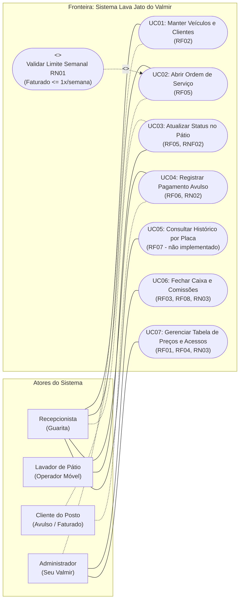
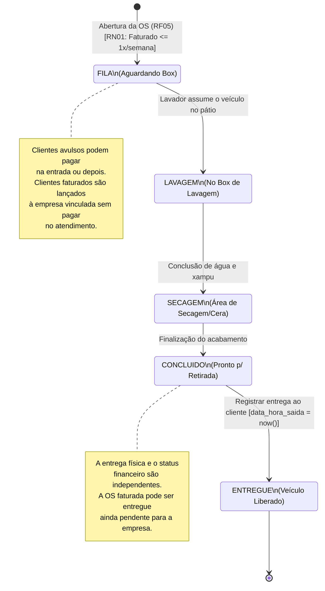
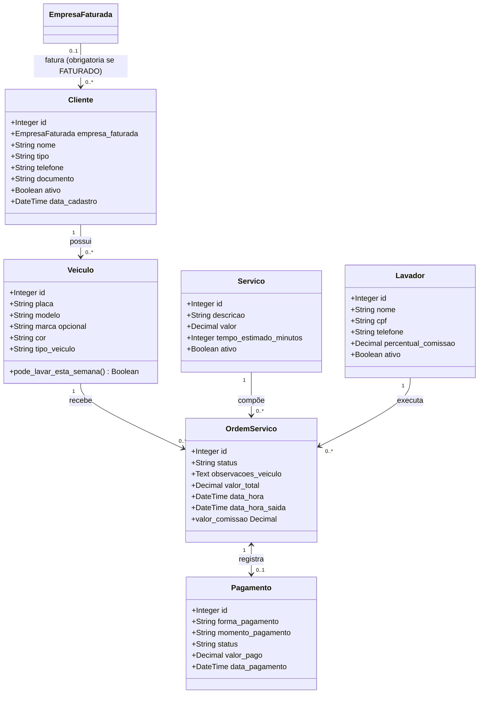
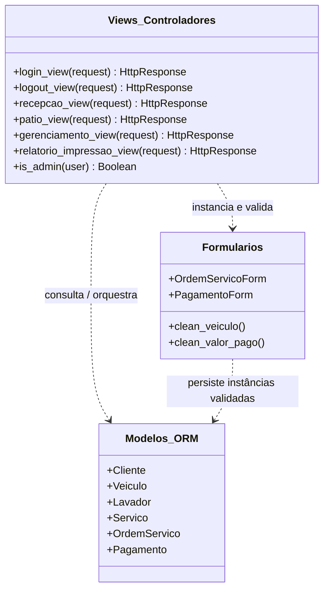

# Diagramas de Engenharia de Software e Validação com Stakeholders
## Sistema de Gestão Operacional e Financeira — Lava Jato do Valmir

* **Instituição:** Centro Universitário de Ensino Superior do Amazonas (CIESA) — Manaus/AM  
* **Curso:** Ciência da Computação / Projetos de Sistemas  
* **Autor:** Ednaldo Maciel da Silva  
* **Data:** Novembro / 2026  
* **Versão:** 2.0 (Atualizado e compatibilizado com a implementação Django, regras de negócio e validações em campo)  
* **Localização dos arquivos editáveis:** [`diagrams/`](../diagrams/)

---

## 1. Visão Geral da Validação com Stakeholders

Os diagramas técnicos deste projeto foram utilizados como **instrumentos de diálogo, alinhamento e homologação** entre o desenvolvedor e os atores reais do negócio (*stakeholders*), capturados durante a pesquisa-ação e entrevistas semiestruturadas no pátio do estabelecimento:

1. **Seu Valmir (Proprietário e Administrador):** Validou as travas de convênios corporativos (**RN01**), a restrição de alteração de preços e fechamento de caixa (**RN03**) e a consolidação de relatórios financeiros e comissões (**RF08**).
2. **Recepcionista (Operadora da Guarita):** O fluxo previsto inclui busca por placa e abertura da OS. Não há comprovante individual de entrada implementado.
3. **Equipe de Lavadores do Pátio:** O quadro acompanha os estados *Fila &rarr; Lavagem &rarr; Secagem &rarr; Concluído &rarr; Entregue* e registra a data/hora de saída na entrega.
4. **Clientes Faturados (Gestores de Frotas Conveniadas):** Validaram a regra de bloqueio semanal estrito de 1 lavagem por veículo (**RN01**) e a emissão do espelho de faturamento mensal auditável.

---

## 2. Diagrama de Casos de Uso (UML Use Case Diagram)

O Diagrama de Casos de Uso delimita a fronteira do sistema e especifica as interações entre os quatro atores do ecossistema e as funcionalidades da plataforma.

*Arquivo Draw.io correspondente:* [`diagrams/diagrama_de_caso_de_uso.drawio`](../diagrams/diagrama_de_caso_de_uso.drawio)

### Representação Visual (Mermaid)



### Validações Conduzidas
* O gerenciamento e a impressão exigem perfil administrativo. A recepção e o pátio exigem autenticação, mas não têm separação por grupos.
* A tela de recepção busca a placa e permite selecionar o veículo antes de abrir a OS; o histórico completo por placa não está implementado.
* As mudanças de status aparecem na resposta/atualização da página; não há atualização por WebSocket ou mecanismo push.

---

## 3. Diagrama de Transição de Estados (State Machine Diagram)

Modela os estados operacionais pelos quais um veículo e sua respectiva Ordem de Serviço transitam desde a entrada na recepção até a liberação final no pátio, conectando o fluxo físico com a liquidação financeira (**RN02**).

*Arquivo Draw.io correspondente:* [`diagrams/diagrama_de_estado.drawio`](../diagrams/diagrama_de_estado.drawio)

### Representação Visual (Mermaid)



### Validações Conduzidas
* **Lavadores do Pátio:** Validaram a necessidade de separar a etapa de lavagem bruta com água/xampu (`LAVAGEM`) da etapa de acabamento/cera/aspiração (`SECAGEM`), pois isso permite liberar o box molhado para o próximo veículo da fila.
* O fluxo implementado não exige pagamento concluído para mudar de `CONCLUIDO` para `ENTREGUE`; clientes faturados são entregues sem pagamento no atendimento.

---

## 4. Diagrama de Sequência (UML Sequence Diagram)

Detalha as mensagens HTTP síncronas entre os operadores, as views, os modelos e o banco durante o atendimento. Não há integração assíncrona nem gateway de pagamento externo.

*Arquivo Draw.io correspondente:* [`diagrams/diagrama_sequencia.drawio`](../diagrams/diagrama_sequencia.drawio)

### Representação Visual (Mermaid)

```mermaid
sequenceDiagram
    autonumber
    actor Cliente as Cliente
    actor Recepcao as Recepcionista
    participant View as RecepcaoView (Django)
    participant Veiculo as Veiculo (Model ORM)
    participant OS as OrdemServico (Model ORM)
    actor Lavador as Lavador (Pátio Móvel)

    Cliente->>Recepcao: Chega com veículo e solicita lavagem
    Recepcao->>View: Informa placa (ex: QZZ1A23)
    View->>Veiculo: Consulta placa e cliente vinculado
    Veiculo-->>View: Retorna objeto Veiculo
    
    View->>Veiculo: pode_lavar_esta_semana() (Regra RN01)
    
    alt Veículo Faturado já lavou na semana corrente
        Veiculo-->>View: Retorna (False, "Limite semanal atingido")
        View-->>Recepcao: Exibe Alerta Vermelho de Bloqueio RN01
        Recepcao-->>Cliente: Informa o bloqueio; não converte automaticamente para atendimento avulso
    else Permitido ou Cliente Avulso
        Veiculo-->>View: Retorna (True, "")
        View-->>Recepcao: Renderiza formulário preenchido com dados do veículo
        
        Recepcao->>View: Seleciona serviço e lavador
        
        alt Cliente avulso
            opt Pagamento imediato
                Recepcao->>View: Registra pagamento (PIX/Dinheiro/Cartão)
            end
        else Cliente faturado
            View->>View: Lança valor pendente para empresa vinculada
        end

        View->>OS: Salva OrdemServico(status='FILA', valor_total=valor)
        OS-->>View: Confirma persistência e gera número da OS
        View->>View: Cria pagamento avulso ou lançamento FATURADO pendente

        Note over OS,Lavador: Operador atualiza o quadro por requisições HTTP
        Lavador->>View: Atualiza status em /patio/
        View->>OS: Atualiza FILA -> LAVAGEM -> SECAGEM -> CONCLUIDO -> ENTREGUE
        OS-->>View: Registra data_hora_saida ao marcar ENTREGUE

        opt Cliente avulso deixou pagamento pendente
            Recepcao->>View: Registra pagamento pendente posteriormente
        end

        Recepcao->>Cliente: Entrega veículo; pagamento não é pré-condição
    end
```

### Validações Conduzidas
* Para veículos faturados, a recepção bloqueia nova OS quando a regra semanal não permite. O sistema não oferece exceção nem conversão automática para cliente avulso.
* O tempo de atendimento inferior a 45 segundos é uma meta e não possui medição documentada.

---

## 5. Diagrama de Classes Conceitual / Modelo de Domínio

Representa a estrutura estrutural das classes do domínio de negócio levantadas nas sessões de elicitação, suas propriedades fundamentais e multiplicidades relacionais.

*Arquivo Draw.io correspondente:* [`diagrams/diagrama_de_classe_conceitual.drawio`](../diagrams/diagrama_de_classe_conceitual.drawio)

### Representação Visual (Mermaid)



### Validações Conduzidas
* **Seu Valmir:** Homologou que a comissão do lavador não é fixa em valor monetário bruto, mas sim uma alíquota percentual (`percentual_comissao`) calculada dinamicamente sobre o valor do serviço executado (**RF03**).
* Para OS faturadas, o registro financeiro usa `forma_pagamento='FATURADO'` e `status='PENDENTE'`; a tela não oferece pagamento imediato.

---

## 6. Diagrama de Classes de Projeto (Arquitetura Django MVT)

Descreve a estrutura técnica de implementação em código, demonstrando o baixo acoplamento e a alta coesão entre a Camada View, Camada Form e Camada Model (ORM) do Django.

*Arquivo Draw.io correspondente:* [`diagrams/diagrama_de_classe_projeto.drawio`](../diagrams/diagrama_de_classe_projeto.drawio)

### Representação Visual (Mermaid)



---

## 7. Matriz Comparativa: Validação Pré vs. Pós Intervenção

| Elemento / Processo | Cenário Pré-Intervenção (Manual / Analógico) | Cenário Pós-Intervenção (Diagramado e Implementado) | Stakeholder Validador |
| :--- | :--- | :--- | :--- |
| **Abertura de Atendimento** | Tiras de papel rascunho cortadas com régua e preenchidas a caneta (`PLACA`, `COR`, `VALOR`). | Busca preditiva por placa na interface web responsiva com abertura de OS em menos de 45 segundos. | Recepcionista e Seu Valmir |
| **Controle de Frotas Faturadas** | Planilha impressa estática na parede; lavagens duplicadas na semana passavam despercebidas. | Bloqueio automático de lavagens excedentes na mesma semana (**RN01**) via método `pode_lavar_esta_semana()`. | Gestor de Frota e Seu Valmir |
| **Comissões dos Lavadores** | Prancheta de madeira com somatórios lineares a caneta (`2,00 + 2,00 + 10,00`) e calculadora Casio de mesa. | Cálculo automático e dinâmico da comissão (**RF03**), com extrato diário individual por lavador e sem rasuras. | Sérgio, Elias, Matheus, Romário, Narciso, Nildo e Oscar |
| **Fechamento Financeiro** | Soma manual no fim do dia; notas e moedas soltas na gaveta sem conciliação com as comandas. | Dashboard administrativo com filtros diários, mensais, por método de pagamento e espelho de impressão A4/PDF. | Seu Valmir (Administrador) |
