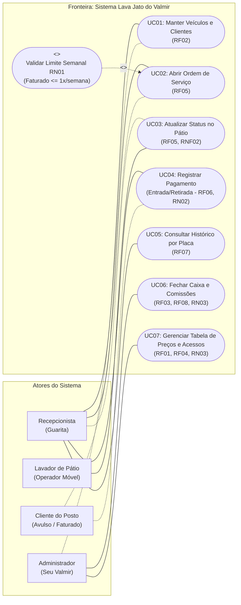
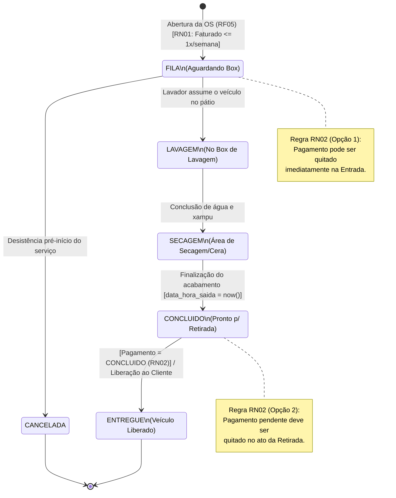
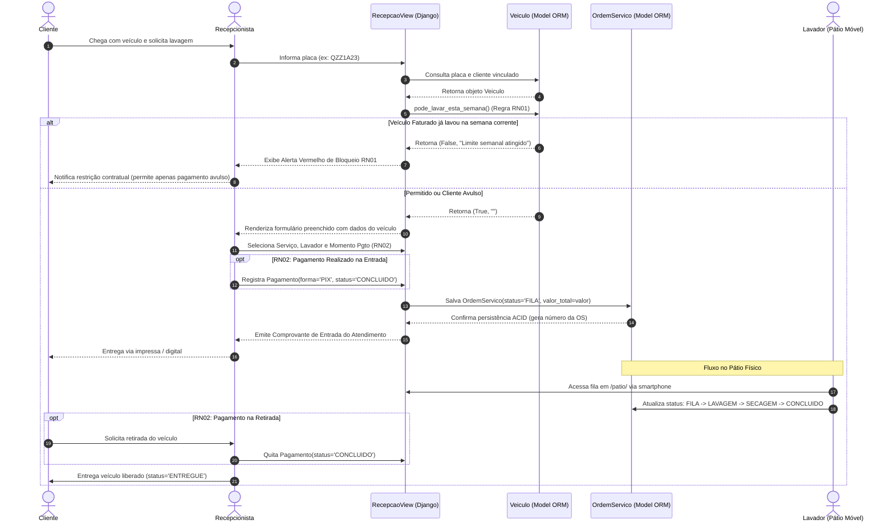
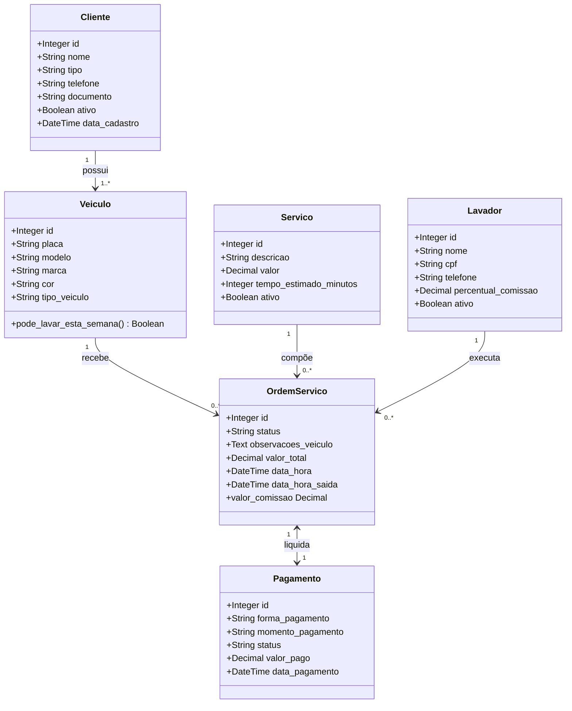
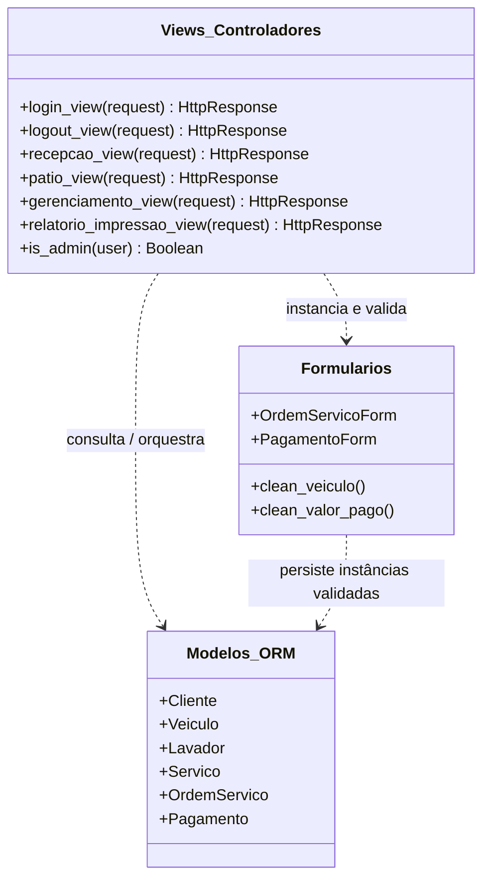

# Diagramas de Engenharia de Software e Validação com Stakeholders
## Sistema de Gestão Operacional e Financeira — Lava Jato do Valmir

* **Instituição:** Centro Universitário de Ensino Superior do Amazonas (CIESA) — Manaus/AM  
* **Curso:** Ciência da Computação / Projetos de Sistemas  
* **Autor:** Ednaldo Maciel da Silva  
* **Data:** Novembro / 2026  
* **Versão:** 2.0 (Atualizado e compatibilizado com a implementação Django, regras de negócio e validações em campo)  
* **Localização dos arquivos editáveis:** [`diagrams/`](file:///c:/Users/Ednaldo%20Maciel/projeto_posto_de_lavagem_ciesa/diagrams/)

---

## 1. Visão Geral da Validação com Stakeholders

Os diagramas técnicos deste projeto foram utilizados como **instrumentos de diálogo, alinhamento e homologação** entre o desenvolvedor e os atores reais do negócio (*stakeholders*), capturados durante a pesquisa-ação e entrevistas semiestruturadas no pátio do estabelecimento:

1. **Seu Valmir (Proprietário e Administrador):** Validou as travas de convênios corporativos (**RN01**), a restrição de alteração de preços e fechamento de caixa (**RN03**) e a consolidação de relatórios financeiros e comissões (**RF08**).
2. **Recepcionista (Operadora da Guarita):** Validou o fluxo de busca ágil por placa, a emissão de comprovantes de entrada e a flexibilidade no momento de cobrança na entrada ou saída (**RN02**).
3. **Equipe de Lavadores do Pátio (Sérgio, Elias, Matheus, Romário, Narciso, Nildo e Oscar):** Validaram o ciclo de vida dos veículos no pátio (*Fila &rarr; Lavagem &rarr; Secagem &rarr; Concluído*), o acompanhamento via dispositivo móvel (**RNF02**) e a fórmula de apuração individual de comissão percentual (**RF03**).
4. **Clientes Faturados (Gestores de Frotas Conveniadas):** Validaram a regra de bloqueio semanal estrito de 1 lavagem por veículo (**RN01**) e a emissão do espelho de faturamento mensal auditável.

---

## 2. Diagrama de Casos de Uso (UML Use Case Diagram)

O Diagrama de Casos de Uso delimita a fronteira do sistema e especifica as interações entre os quatro atores do ecossistema e as funcionalidades da plataforma.

*Arquivo Draw.io correspondente:* [`diagrams/diagrama_de_caso_de_uso.drawio`](file:///c:/Users/Ednaldo%20Maciel/projeto_posto_de_lavagem_ciesa/diagrams/diagrama_de_caso_de_uso.drawio)

### Representação Visual (Mermaid)

### Validações Conduzidas
* **Seu Valmir:** Homologou que os casos de uso **UC06** (fechamento de caixa e conferência de comissões) e **UC07** (alteração de tabela de preços e gestão de usuários) são de acesso estrito e exclusivo do Administrador via perfil RBAC (**RN03**).
* **Recepcionista:** Homologou que a abertura de OS (**UC02**) integra a busca automática de clientes já cadastrados (**UC01**) em uma única tela.
* **Lavadores:** Homologaram que a única ação necessária em seu aplicativo é transicionar o status da lavagem (**UC03**) em tempo real.

---

## 3. Diagrama de Transição de Estados (State Machine Diagram)

Modela os estados operacionais pelos quais um veículo e sua respectiva Ordem de Serviço transitam desde a entrada na recepção até a liberação final no pátio, conectando o fluxo físico com a liquidação financeira (**RN02**).

*Arquivo Draw.io correspondente:* [`diagrams/diagrama_de_estado.drawio`](file:///c:/Users/Ednaldo%20Maciel/projeto_posto_de_lavagem_ciesa/diagrams/diagrama_de_estado.drawio)

### Representação Visual (Mermaid)

### Validações Conduzidas
* **Lavadores do Pátio:** Validaram a necessidade de separar a etapa de lavagem bruta com água/xampu (`LAVAGEM`) da etapa de acabamento/cera/aspiração (`SECAGEM`), pois isso permite liberar o box molhado para o próximo veículo da fila.
* **Recepcionista e Seu Valmir:** Validaram que um carro com status `CONCLUIDO` só transiciona para `ENTREGUE` se o registro de pagamento estiver com `status = 'CONCLUIDO'`, impedindo que veículos saiam do pátio sem quitação financeira.

---

## 4. Diagrama de Sequência (UML Sequence Diagram)

Detalha as mensagens síncronas e assíncronas trocadas entre os atores, controladores, modelos de domínio e persistência durante o processo de atendimento, validação de regras de convênio e quitação.

*Arquivo Draw.io correspondente:* [`diagrams/diagrama_sequencia.drawio`](file:///c:/Users/Ednaldo%20Maciel/projeto_posto_de_lavagem_ciesa/diagrams/diagrama_sequencia.drawio)

### Representação Visual (Mermaid)

### Validações Conduzidas
* **Cliente de Frota Faturada:** Validou que o sistema bloqueia instantaneamente a tentativa de realizar lavagens excedentes no ato do atendimento, protegendo a empresa parceira contra faturas com cobranças imprevistas.
* **Recepcionista:** Homologou que o fluxo é contínuo e leva menos de 45 segundos por veículo, eliminando a consulta de papéis em pastas físicas.

---

## 5. Diagrama de Classes Conceitual / Modelo de Domínio

Representa a estrutura estrutural das classes do domínio de negócio levantadas nas sessões de elicitação, suas propriedades fundamentais e multiplicidades relacionais.

*Arquivo Draw.io correspondente:* [`diagrams/diagrama_de_classe_conceitual.drawio`](file:///c:/Users/Ednaldo%20Maciel/projeto_posto_de_lavagem_ciesa/diagrams/diagrama_de_classe_conceitual.drawio)

### Representação Visual (Mermaid)

### Validações Conduzidas
* **Seu Valmir:** Homologou que a comissão do lavador não é fixa em valor monetário bruto, mas sim uma alíquota percentual (`percentual_comissao`) calculada dinamicamente sobre o valor do serviço executado (**RF03**).
* **Equipe do Posto:** Homologou que as formas de pagamento suportadas atendem ao cotidiano do estabelecimento: `PIX`, `DINHEIRO`, `CARTAO` e `FATURADO`.

---

## 6. Diagrama de Classes de Projeto (Arquitetura Django MVT)

Descreve a estrutura técnica de implementação em código, demonstrando o baixo acoplamento e a alta coesão entre a Camada View, Camada Form e Camada Model (ORM) do Django.

*Arquivo Draw.io correspondente:* [`diagrams/diagrama_de_classe_projeto.drawio`](file:///c:/Users/Ednaldo%20Maciel/projeto_posto_de_lavagem_ciesa/diagrams/diagrama_de_classe_projeto.drawio)

### Representação Visual (Mermaid)

---

## 7. Matriz Comparativa: Validação Pré vs. Pós Intervenção

| Elemento / Processo | Cenário Pré-Intervenção (Manual / Analógico) | Cenário Pós-Intervenção (Diagramado e Implementado) | Stakeholder Validador |
| :--- | :--- | :--- | :--- |
| **Abertura de Atendimento** | Tiras de papel rascunho cortadas com régua e preenchidas a caneta (`PLACA`, `COR`, `VALOR`). | Busca preditiva por placa na interface web responsiva com abertura de OS em menos de 45 segundos. | Recepcionista e Seu Valmir |
| **Controle de Frotas Faturadas** | Planilha impressa estática na parede; lavagens duplicadas na semana passavam despercebidas. | Bloqueio automático de lavagens excedentes na mesma semana (**RN01**) via método `pode_lavar_esta_semana()`. | Gestor de Frota e Seu Valmir |
| **Comissões dos Lavadores** | Prancheta de madeira com somatórios lineares a caneta (`2,00 + 2,00 + 10,00`) e calculadora Casio de mesa. | Cálculo automático e dinâmico da comissão (**RF03**), com extrato diário individual por lavador e sem rasuras. | Sérgio, Elias, Matheus, Romário, Narciso, Nildo e Oscar |
| **Fechamento Financeiro** | Soma manual no fim do dia; notas e moedas soltas na gaveta sem conciliação com as comandas. | Dashboard administrativo com filtros diários, mensais, por método de pagamento e espelho de impressão A4/PDF. | Seu Valmir (Administrador) |
