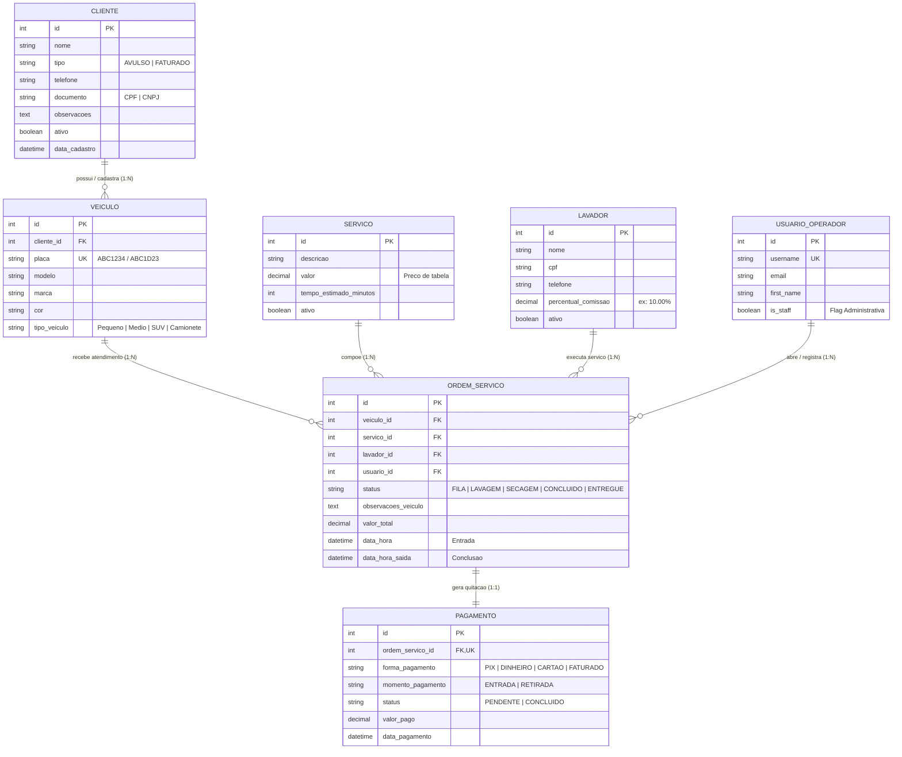

# Modelagem de Dados Conceitual e Lógica
## Sistema de Gestão Operacional e Financeira — Lava Jato do Valmir

* **Instituição:** Centro Universitário de Ensino Superior do Amazonas (CIESA) — Manaus/AM  
* **Curso:** Ciência da Computação / Sistemas de Informação  
* **Autor:** Ednaldo Maciel da Silva  
* **Data:** Novembro / 2026  
* **Versão:** 2.0 (Atualizado e compatibilizado com o Django ORM, PostgreSQL e regras de negócio RN01, RN02, RN03)  
* **Status:** Aprovado e Implementado

---

## 1. Visão Geral e Fundamentação Teórica

A modelagem de dados deste projeto foi concebida para estruturar e automatizar os fluxos de pátio e caixa do microempreendimento **Lava Jato do Valmir**, substituindo as antigas fichas de papel rascunho e cadernos manuais por uma base relacional robusta, íntegra e auditável.

A modelagem segue as diretrizes clássicas da Engenharia de Dados e Bancos de Dados Relacionais:
1. **Nível Conceitual (Modelo Entidade-Relacionamento - MER/DER):** Abstrai as regras e processos de negócio do pátio em entidades, atributos e relacionamentos com suas respectivas cardinalidades, fundamentado no modelo seminal de Peter Chen (1976).
2. **Nível Lógico (Modelo Relacional e Normalização):** Converte o modelo conceitual para esquemas relacionais de tabelas, chaves primárias (PK), chaves estrangeiras (FK), restrições de integridade e demonstração de conformidade com a **Terceira Forma Normal (3FN)**, segundo Edgar F. Codd (1970).
3. **Nível Físico / Mapeamento Objeto-Relacional (ORM):** Mapeamento 1:1 com as classes Python do Django ORM ([`backend/lavajato/models.py`](file:///c:/Users/Ednaldo%20Maciel/projeto_posto_de_lavagem_ciesa/backend/lavajato/models.py)) e com o script DDL SQL padrão ANSI ([`database/schema.sql`](file:///c:/Users/Ednaldo%20Maciel/projeto_posto_de_lavagem_ciesa/database/schema.sql)), operando sobre SQLite3 (Dev) e PostgreSQL (Prod) via `DATABASE_URL` (ADR-002).

---

## 2. Matriz de Rastreabilidade (Requisitos &times; Modelo de Dados)

| Requisito / Regra | Descrição no Negócio | Entidade / Coluna de Mapeamento |
| :--- | :--- | :--- |
| **RF01 / RNF05** | Controle de usuários com perfis distintos (Administrador vs Recepcionista). | `auth_user` e `auth_group` integrados via Django Auth. |
| **RF02** | Cadastro e segmentação de clientes (Avulso vs Faturado / Convênio Corporativo). | Entidade `Cliente` (campo `tipo`: `AVULSO` ou `FATURADO`). |
| **RF02 / RN01** | Cadastro de veículos por placa e validação da regra de limite semanal (máx. 1 lavagem/sem). | Entidade `Veiculo` (campo `placa` `UNIQUE` e método `pode_lavar_esta_semana()`). |
| **RF03** | Cadastro de lavadores e cálculo automático de comissão individual por serviço. | Entidade `Lavador` (campo `percentual_comissao`) e cálculo dinâmico na OS. |
| **RF04 / RN03** | Tabela de serviços com valores base gerenciados exclusivamente pelo Administrador. | Entidade `Servico` (campos `valor`, `tempo_estimado_minutos`, `ativo`). |
| **RF05** | Emissão e acompanhamento de Ordens de Serviço (OS) com estados em tempo real. | Entidade `OrdemServico` (`FILA`, `LAVAGEM`, `SECAGEM`, `CONCLUIDO`, `ENTREGUE`). |
| **RF06 / RN02** | Registro de pagamentos com flexibilidade no momento de quitação (Entrada ou Retirada). | Entidade `Pagamento` (campos `momento_pagamento`, `forma_pagamento`, `status`). |
| **RF07 / RF08** | Histórico por placa, fechamento de caixa diário e relatórios de auditoria/faturamento. | Consultas agregadas e índices de performance sobre `OrdemServico` e `Pagamento`. |

---

## 3. Modelagem Conceitual (MER / DER)

### 3.1 Definição das Entidades do Domínio

1. **`CLIENTE` (Entidade Forte):** Representa o tomador do serviço. Pode ser uma pessoa física contratante de lavagem avulsa ou uma pessoa jurídica conveniada que fatura serviços mensalmente.
2. **`VEICULO` (Entidade Fraca por Dependência Existencial):** Automóvel levado ao posto. Depende da existência de um cliente proprietário/responsável e é identificado unicamente pela sua placa automotiva normalizada.
3. **`LAVADOR` (Entidade Forte):** Profissional de pátio responsável pela execução operacional da lavagem. Possui taxa percentual de comissão contratada.
4. **`SERVICO` (Entidade Forte):** Catálogo de procedimentos disponíveis no posto (ex.: Lavagem Simples, Geral, Completa, Cera, Higienização) com seus respectivos valores de tabela.
5. **`ORDEM_SERVICO` (Entidade Associativa / Central):** Representa o evento operacional do atendimento. Intersecta o veículo que recebe o serviço, o serviço executado, o lavador responsável, o operador do sistema que realizou a recepção e o ciclo de vida do atendimento no pátio.
6. **`PAGAMENTO` (Entidade Dependente / Associada):** Transação financeira que liquida ou fatura a Ordem de Serviço, registrando momento da cobrança, método e status de quitação.
7. **`USUARIO_OPERADOR` (Entidade Forte / Sistema):** Ator humano que opera o sistema (Recepcionista ou Administrador).

### 3.2 Diagrama Entidade-Relacionamento Conceitual (Mermaid)



### 3.3 Cardinalidades e Semântica de Negócio

* **CLIENTE &rarr; VEICULO ($1:N$):** Um cliente pode possuir múltiplos veículos vinculados (situação típica de empresas de frota conveniada), mas cada veículo pertence a exatamente um cliente titular.
* **VEICULO &rarr; ORDEM_SERVICO ($1:N$):** Um veículo pode realizar diversos atendimentos ao longo do tempo. **Regra RN01:** Se o veículo pertencer a um cliente com `tipo = 'FATURADO'`, o motor do domínio restringe as instâncias de OS para no máximo 1 atendimento na mesma semana corrente (Segunda-feira a Domingo).
* **SERVICO &rarr; ORDEM_SERVICO ($1:N$):** Um tipo de serviço de tabela pode ser solicitado em milhares de ordens de serviço. A alteração de valores de tabela afeta apenas novos lançamentos, preservando o valor histórico cobrado em `valor_total`.
* **LAVADOR &rarr; ORDEM_SERVICO ($1:N$):** Um lavador executa diversas ordens de serviço ao longo do dia de trabalho. A alíquota cadastrada no lavador determina a apuração do valor de comissão (**RF03**).
* **USUARIO_OPERADOR &rarr; ORDEM_SERVICO ($1:N$):** Um operador da recepção abre diversas ordens de serviço durante seu expediente.
* **ORDEM_SERVICO &rarr; PAGAMENTO ($1:1$):** Cada Ordem de Serviço possui exatamente um registro financeiro acoplado. **Regra RN02:** O pagamento pode ser concluído imediatamente na abertura (`momento_pagamento = 'ENTRADA'`) ou registrado como pendente para quitação no resgate do veículo (`momento_pagamento = 'RETIRADA'`).

---

## 4. Modelagem Lógica (Modelo Relacional)

A modelagem lógica expressa a estrutura em formato relacional de tabelas, com declaração de tipos, chaves primárias (**PK**), chaves estrangeiras (**FK**), unicidades (**UNIQUE**) e restrições de integridade referencial.

### 4.1 Esquema Relacional Formal

$$\begin{aligned}
\text{\textbf{CLIENTE}} & (\underline{\text{id}}, \text{nome}, \text{tipo}, \text{telefone}, \text{documento}, \text{observacoes}, \text{ativo}, \text{data\_cadastro}) \\
\text{\textbf{VEICULO}} & (\underline{\text{id}}, \text{cliente\_id}^*, \text{placa}^{\text{UQ}}, \text{modelo}, \text{marca}, \text{cor}, \text{tipo\_veiculo}) \\
\text{\textbf{LAVADOR}} & (\underline{\text{id}}, \text{nome}, \text{cpf}, \text{telefone}, \text{percentual\_comissao}, \text{ativo}) \\
\text{\textbf{SERVICO}} & (\underline{\text{id}}, \text{descricao}, \text{valor}, \text{tempo\_estimado\_minutos}, \text{ativo}) \\
\text{\textbf{ORDEM\_SERVICO}} & (\underline{\text{id}}, \text{veiculo\_id}^*, \text{servico\_id}^*, \text{lavador\_id}^*, \text{usuario\_id}^*, \text{status}, \text{observacoes\_veiculo}, \text{valor\_total}, \text{data\_hora}, \text{data\_hora\_saida}) \\
\text{\textbf{PAGAMENTO}} & (\underline{\text{id}}, \text{ordem\_servico\_id}^{*, \text{UQ}}, \text{forma\_pagamento}, \text{momento\_pagamento}, \text{status}, \text{valor\_pago}, \text{data\_pagamento}) \\
\text{\textbf{AUTH\_USER}} & (\underline{\text{id}}, \text{username}^{\text{UQ}}, \text{password}, \text{email}, \text{first\_nome}, \text{is\_staff}, \text{is\_active}, \text{date\_joined})
\end{aligned}$$

*Legenda: $\underline{\text{Sublinhado}} = \text{Chave Primária (PK)}$; $* = \text{Chave Estrangeira (FK)}$; $\text{UQ} = \text{Restrição de Unicidade (UNIQUE)}$.*

---

### 4.2 Prova de Normalização (1FN, 2FN e 3FN)

A estrutura do banco de dados do *Lava Jato do Valmir* foi normalizada rigorosamente até a **Terceira Forma Normal (3FN)**:

#### 1. Primeira Forma Normal (1FN)
* *Definição:* Todos os atributos contêm apenas valores atômicos e indivisíveis, sem tabelas aninhadas, vetores ou listas multivaloradas.
* *Aplicação:*
  * Nomes, telefones, placas e valores estão decompostos em atributos elementares.
  * Formas de pagamento, momentos de quitação e status do pátio são tratados por valores atômicos padronizados via restrições `CHECK` ou enums controlados.
  * Placas de veículos são limpas de máscaras e hifens (`ABC1234`), garantindo unicidade atômica.

#### 2. Segunda Forma Normal (2FN)
* *Definição:* O esquema está na 1FN e todo atributo não-chave depende funcionalmente por inteiro de cada chave candidata da tabela (ausência de dependências funcionais parciais).
* *Aplicação:*
  * Todas as tabelas do sistema utilizam chaves primárias simples baseadas em identificadores artificiais substitutos (`id SERIAL` / Auto-Increment).
  * Como nenhuma tabela possui chave primária composta, **não existe possibilidade matemática de dependência parcial**, estando o sistema naturalmente e integralmente em conformidade com a 2FN.

#### 3. Terceira Forma Normal (3FN)
* *Definição:* O esquema está na 2FN e nenhum atributo não-chave depende transitivamente de outra coluna que não seja a própria chave primária ($X \to Y \to Z$).
* *Aplicação:*
  * Na tabela `ORDEM_SERVICO`, não se armazenam os dados cadastrais do cliente ou do veículo (como marca, modelo ou telefone), apenas a referência `veiculo_id`. A busca por dados do proprietário ocorre via junção relacional ($OS \to Veiculo \to Cliente$).
  * Na tabela `ORDEM_SERVICO`, a alíquota percentual do lavador não é copiada para a linha; utiliza-se a chave `lavador_id`, garantindo que eventuais ajustes contratuais do lavador estejam centralizados em sua própria entidade.
  * O campo `valor_total` em `ORDEM_SERVICO` registra o valor cobrado congelado daquela transação específica, não gerando dependência transitiva com a tabela `SERVICO`, pois visa garantir integridade contábil histórica contra alterações futuras de preço de tabela.

---

## 5. Dicionário de Dados Completo (Metadados Técnicos)

### 5.1 Tabela: `lavajato_cliente` (ou `Cliente`)
Armazena os tomadores de serviço avulsos e clientes corporativos de frotas conveniadas.

| Coluna | Tipo SQL | Tipo Django | Nulo | Restrições | Descrição / Regra de Negócio |
| :--- | :--- | :--- | :---: | :--- | :--- |
| `id` | `INTEGER / SERIAL` | `BigAutoField` | Não | `PRIMARY KEY` | Identificador único surrogate do cliente. |
| `nome` | `VARCHAR(120)` | `CharField` | Não | — | Nome completo da pessoa física ou razão social. |
| `tipo` | `VARCHAR(20)` | `CharField` | Não | `CHECK IN ('AVULSO', 'FATURADO')` | Segmentação comercial: `AVULSO` (padrão) ou `FATURADO` (sujeito à regra RN01). |
| `telefone` | `VARCHAR(20)` | `CharField` | Sim | — | Telefone ou WhatsApp para contato e aviso de veículo pronto. |
| `documento` | `VARCHAR(25)` | `CharField` | Sim | — | CPF do titular ou CNPJ da empresa conveniada. |
| `observacoes` | `TEXT` | `TextField` | Sim | — | Observações contratuais ou instruções específicas. |
| `ativo` | `BOOLEAN` | `BooleanField` | Não | `DEFAULT TRUE` | Indicador de cliente ativo ou inativado na carteira. |
| `data_cadastro` | `TIMESTAMP` | `DateTimeField` | Não | `DEFAULT timezone.now` | Data e hora de inclusão do registro no sistema. |

---

### 5.2 Tabela: `lavajato_veiculo` (ou `Veiculo`)
Registra os veículos atendidos no pátio e vinculados aos clientes.

| Coluna | Tipo SQL | Tipo Django | Nulo | Restrições | Descrição / Regra de Negócio |
| :--- | :--- | :--- | :---: | :--- | :--- |
| `id` | `INTEGER / SERIAL` | `BigAutoField` | Não | `PRIMARY KEY` | Identificador único surrogate do veículo. |
| `cliente_id` | `INTEGER` | `ForeignKey(Cliente)` | Não | `REFERENCES lavajato_cliente(id) ON DELETE CASCADE` | Cliente proprietário / responsável pelo veículo. |
| `placa` | `VARCHAR(10)` | `CharField` | Não | `UNIQUE`, `INDEX` | Placa automotiva sem hifen, em maiúsculas (ex: `QZZ1A23`). |
| `modelo` | `VARCHAR(50)` | `CharField` | Não | — | Modelo comercial do veículo (ex.: Ônix, Hilux, Gol). |
| `marca` | `VARCHAR(50)` | `CharField` | Não | — | Montadora / Fabricante (ex.: Chevrolet, Toyota, Volkswagen). |
| `cor` | `VARCHAR(30)` | `CharField` | Sim | — | Cor predominante para facilitar localização no pátio. |
| `tipo_veiculo` | `VARCHAR(30)` | `CharField` | Não | `CHECK IN (Pequeno, Médio, SUV, Caminhonete, Van, Outro)` | Porte automotivo para balizamento de preços e tempos. |

---

### 5.3 Tabela: `lavajato_lavador` (ou `Lavador`)
Registra os profissionais de lavagem atuantes no pátio físico do posto.

| Coluna | Tipo SQL | Tipo Django | Nulo | Restrições | Descrição / Regra de Negócio |
| :--- | :--- | :--- | :---: | :--- | :--- |
| `id` | `INTEGER / SERIAL` | `BigAutoField` | Não | `PRIMARY KEY` | Identificador único do lavador. |
| `nome` | `VARCHAR(100)` | `CharField` | Não | — | Nome do lavador (ex: Sérgio, Elias, Matheus, Romário, Narciso, Nildo, Oscar). |
| `cpf` | `VARCHAR(20)` | `CharField` | Sim | — | Registro de CPF do colaborador. |
| `telefone` | `VARCHAR(20)` | `CharField` | Sim | — | Contato telefônico. |
| `percentual_comissao`| `DECIMAL(5,2)` | `DecimalField` | Não | `DEFAULT 10.00` | Percentual de comissão contratual por serviço (RF03). |
| `ativo` | `BOOLEAN` | `BooleanField` | Não | `DEFAULT TRUE` | Situação operacional do profissional na escala. |

---

### 5.4 Tabela: `lavajato_servico` (ou `Servico`)
Catálogo de serviços oferecidos pelo estabelecimento (gestão restrita ao Administrador — RN03).

| Coluna | Tipo SQL | Tipo Django | Nulo | Restrições | Descrição / Regra de Negócio |
| :--- | :--- | :--- | :---: | :--- | :--- |
| `id` | `INTEGER / SERIAL` | `BigAutoField` | Não | `PRIMARY KEY` | Identificador único do serviço. |
| `descricao` | `VARCHAR(100)` | `CharField` | Não | — | Nome do serviço (ex.: Lavagem Geral, Simples, Completa com Cera). |
| `valor` | `DECIMAL(10,2)` | `DecimalField` | Não | `CHECK (valor >= 0)` | Preço base de tabela estipulado pelo Administrador. |
| `tempo_estimado_minutos`| `INTEGER` | `PositiveIntegerField` | Não | `DEFAULT 30` | Tempo médio previsto de execução no pátio. |
| `ativo` | `BOOLEAN` | `BooleanField` | Não | `DEFAULT TRUE` | Flag de disponibilidade no formulário de atendimento. |

---

### 5.5 Tabela: `lavajato_ordemservico` (ou `OrdemServico`)
Entidade central que gerencia o fluxo de trabalho e eventos de atendimento.

| Coluna | Tipo SQL | Tipo Django | Nulo | Restrições | Descrição / Regra de Negócio |
| :--- | :--- | :--- | :---: | :--- | :--- |
| `id` | `INTEGER / SERIAL` | `BigAutoField` | Não | `PRIMARY KEY` | Número sequencial da Ordem de Serviço (OS). |
| `veiculo_id` | `INTEGER` | `ForeignKey(Veiculo)` | Não | `REFERENCES lavajato_veiculo(id) ON DELETE PROTECT` | Veículo atendido na OS (sujeito à validação RN01). |
| `servico_id` | `INTEGER` | `ForeignKey(Servico)` | Não | `REFERENCES lavajato_servico(id) ON DELETE PROTECT` | Procedimento executado no veículo. |
| `lavador_id` | `INTEGER` | `ForeignKey(Lavador)` | Não | `REFERENCES lavajato_lavador(id) ON DELETE PROTECT` | Lavador de pátio designado para o serviço (RF03). |
| `usuario_id` | `INTEGER` | `ForeignKey(User)` | Não | `REFERENCES auth_user(id) ON DELETE PROTECT` | Atendente / Operador responsável pelo lançamento. |
| `status` | `VARCHAR(30)` | `CharField` | Não | `CHECK IN ('FILA', 'LAVAGEM', 'SECAGEM', 'CONCLUIDO', 'ENTREGUE')` | Estado em tempo real do veículo no pátio físico. |
| `observacoes_veiculo`| `TEXT` | `TextField` | Sim | — | Vistoria de entrada (avarias prévias, arranhões, pertences). |
| `valor_total` | `DECIMAL(10,2)` | `DecimalField` | Sim | `CHECK (valor_total >= 0)` | Valor final cobrado (congela o valor do serviço na data). |
| `data_hora` | `TIMESTAMP` | `DateTimeField` | Não | `DEFAULT timezone.now`, `INDEX` | Data e hora de entrada do veículo na oficina. |
| `data_hora_saida` | `TIMESTAMP` | `DateTimeField` | Sim | — | Registro de conclusão do serviço e liberação do pátio. |

---

### 5.6 Tabela: `lavajato_pagamento` (ou `Pagamento`)
Transações financeiras e controle de conciliação de caixa diário (RF06, RN02).

| Coluna | Tipo SQL | Tipo Django | Nulo | Restrições | Descrição / Regra de Negócio |
| :--- | :--- | :--- | :---: | :--- | :--- |
| `id` | `INTEGER / SERIAL` | `BigAutoField` | Não | `PRIMARY KEY` | Identificador único do pagamento. |
| `ordem_servico_id` | `INTEGER` | `OneToOneField(OrdemServico)`| Não | `UNIQUE`, `REFERENCES lavajato_ordemservico(id) ON DELETE CASCADE` | Relação 1:1 estrita com a Ordem de Serviço liquidada. |
| `forma_pagamento` | `VARCHAR(30)` | `CharField` | Não | `CHECK IN ('PIX', 'DINHEIRO', 'CARTAO', 'FATURADO')` | Modalidade financeira de recebimento. |
| `momento_pagamento`| `VARCHAR(20)` | `CharField` | Não | `CHECK IN ('ENTRADA', 'RETIRADA')` | **Regra RN02:** Flexibilidade de quitação na entrada ou saída. |
| `status` | `VARCHAR(20)` | `CharField` | Não | `CHECK IN ('PENDENTE', 'CONCLUIDO')` | Status da quitação (`PENDENTE` para pagamento na saída). |
| `valor_pago` | `DECIMAL(10,2)` | `DecimalField` | Não | `CHECK (valor_pago >= 0)` | Montante financeiro pago e auditado. |
| `data_pagamento` | `TIMESTAMP` | `DateTimeField` | Não | `DEFAULT timezone.now` | Timestamp do ato de quitação financeira. |

---

## 6. Integridade Referencial, Transações e Performance

### 6.1 Políticas de Integridade e Ações em Cascata (`ON DELETE`)

A integridade do modelo foi desenhada para garantir **segurança fiscal e contábil**:
1. **`ON DELETE PROTECT` nas Chaves Estrangeiras Críticas da OS:**
   * A exclusão física de um `Veiculo`, `Servico`, `Lavador` ou `Usuario` é bloqueada caso existam registros históricos em `OrdemServico`. Isso impede que relatórios financeiros e contábeis de fechamento diário percam suas referências históricas.
2. **`ON DELETE CASCADE` Estritamente Delimitado:**
   * Caso uma `OrdemServico` de teste seja excluída, seu respectivo registro em `Pagamento` é removido em cascata, evitando transações órfãs.
   * Se um `Cliente` for excluído, seus veículos cadastrados são removidos em cascata (desde que não possuam ordens de serviço protegidas).

### 6.2 Implementação das Regras de Negócio no Domínio

As regras de negócio mais complexas não foram relegadas apenas ao banco ou a formulários superficiais, mas sim encapsuladas no núcleo do domínio (ADR-003):
* **Regra RN01 (Limite de 1 lavagem semanal para frotas faturadas):**
  Implementada no método `pode_lavar_esta_semana()` de `Veiculo` e validada automaticamente no método `clean()` de `OrdemServico`:
  $$\text{inicio\_semana} = (\text{hoje} - \text{dias}(\text{weekday})).replace(hour=0, minute=0, second=0)$$
  Qualquer tentativa de persistir uma OS duplicada no mesmo intervalo semanal para veículos de clientes faturados dispara uma exceção `ValidationError`, impedindo gravação espúria.
* **Cálculo da Comissão Individual (RF03):**
  Implementado como propriedade dinâmica em `OrdemServico.valor_comissao`:
  $$\text{Comissão} = \text{valor\_total} \times \left(\frac{\text{percentual\_comissao}}{100}\right)$$

### 6.3 Estratégia de Indexação e Desempenho (RNF03)

Para assegurar que o tempo de resposta em consultas e buscas por placa na guarita de atendimento permaneça estritamente inferior a **2 segundos (RNF03)**, foram definidos os seguintes índices B-Tree:

```sql
-- Índices para busca ultra-rápida por placa na recepção
CREATE INDEX idx_veiculo_placa ON lavajato_veiculo(placa);
CREATE INDEX idx_veiculo_cliente ON lavajato_veiculo(cliente_id);

-- Índices para painel de pátio em tempo real e fechamento financeiro
CREATE INDEX idx_os_data_hora ON lavajato_ordemservico(data_hora);
CREATE INDEX idx_os_status ON lavajato_ordemservico(status);
CREATE INDEX idx_os_veiculo ON lavajato_ordemservico(veiculo_id);
```

No Django ORM, as consultas críticas nos controladores utilizam a técnica `select_related('veiculo', 'servico', 'lavador', 'usuario')`, eliminando o problema clássico de $N+1$ consultas e trazendo todo o grafo de objetos em uma única consulta SQL otimizada.
