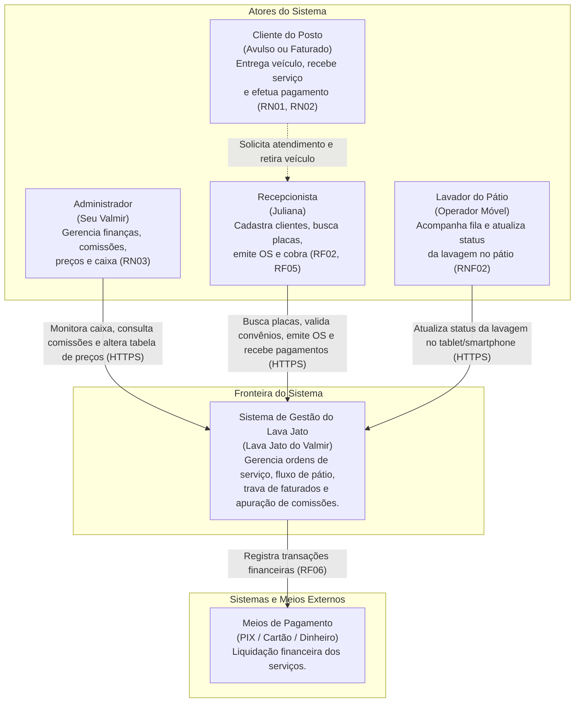
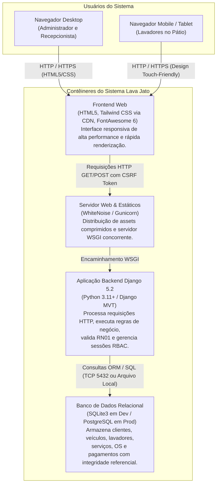
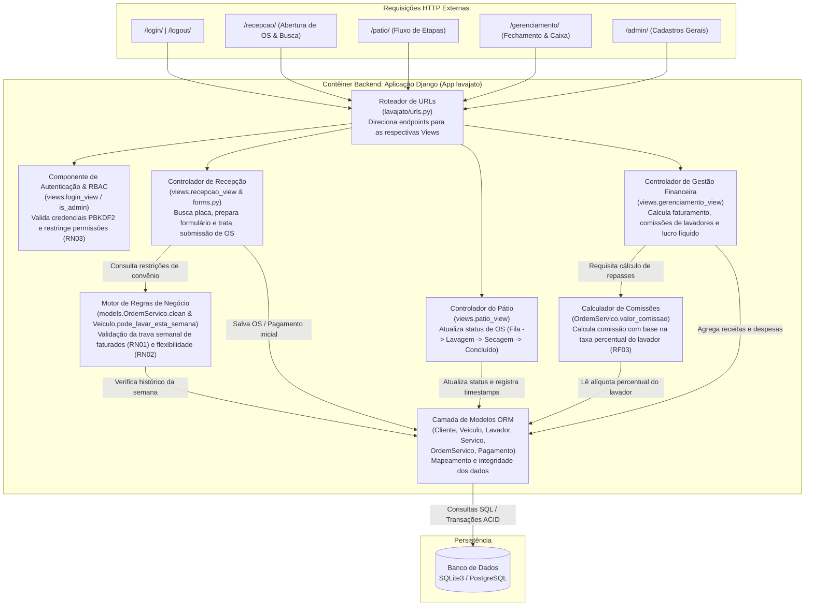

# Especificação de Requisitos e Matriz de Rastreabilidade

**Projeto:** Sistema de Gerenciamento de Posto de Lavagem (Lava Jato do Valmir)  
**Instituição:** CIESA  
**Autor:** Ednaldo Maciel da Silva  
**Versão:** 1.2 (Atualizado com base nas entrevistas de Julho/2026)  

---

## 1. Requisitos Funcionais (RF)

| ID | Descrição | Prioridade | Fonte / Origem de Elicitação |
| :--- | :--- | :--- | :--- |
| **RF01** | **Gerenciar usuários:** Cadastrar, editar, consultar e inativar utilizadores com perfis distintos (Administrador e Recepcionista). | Alta | Entrevista 01 (Seu Valmir) |
| **RF02** | **Gerenciar veículos e frotas:** Cadastrar, editar, consultar e vincular veículos a clientes avulsos ou faturados (empresas parceiras). | Alta | Entrevistas 03 e 04 (Clientes) |
| **RF03** | **Gerenciar lavadores e comissões:** Registrar lavadores e calcular automaticamente a comissão diária/semanal por serviço executado. | Alta | Entrevistas 01 e 02 (Lavadores) |
| **RF04** | **Gerenciar serviços e preços:** Cadastrar e editar tipos de lavagem e respetivos valores da tabela (acesso restrito). | Média | Entrevista 01 (Seu Valmir) |
| **RF05** | **Registrar Ordem de Serviço (OS):** Criar OS vinculando veículo, serviço, lavador por ordem de chegada e atualizar status em tempo real (Fila, Em Lavagem, Secagem, Concluído). | Alta | Entrevista 02 e Observação Direta |
| **RF06** | **Registrar pagamentos e comprovantes:** Registrar recebimentos flexíveis (Dinheiro, PIX, Cartão) no ato da entrada ou saída e emitir comprovante de atendimento. | Alta | Entrevista 04 e Análise Documental |
| **RF07** | **Consultar histórico:** Consultar o histórico completo de lavagens, serviços executados e atendimentos por placa ou cliente. | Média | Entrevista 03 (Cliente Faturado) |
| **RF08** | **Gerar relatórios operacionais e financeiros:** Gerar relatórios de fechamento de caixa diário e comissões para conferência com os lavadores. | Média | Entrevistas 01, 02 e Análise Documental |

---

## 2. Requisitos Não Funcionais (RNF)

| ID | Descrição | Categoria | Fonte / Origem |
| :--- | :--- | :--- | :--- |
| **RNF01** | O sistema deve possuir controlo de acesso e autenticação via login e palavra-passe encriptada. | Segurança | Entrevista 01 (Seu Valmir) |
| **RNF02** | O sistema deve possuir interface responsiva e leve para consulta rápida e acompanhamento dos lavadores via dispositivos móveis (smartphones/tablets no pátio). | Usabilidade | Entrevista 02 (Lavadores no pátio) |
| **RNF03** | O tempo de resposta para consultas no sistema (procura por placa ou cliente) deve ser inferior a 2 segundos. | Desempenho | Entrevista 04 (Cliente Avulso) |
| **RNF04** | O sistema deve realizar cópias de segurança (backup) periódicas e automatizadas da base de dados. | Confiabilidade | Análise Documental |
| **RNF05** | O sistema deve garantir restrição de funcionalidades por nível de perfil (Administrador x Recepcionista). | Segurança | Entrevista 01 (Seu Valmir) |

---

## 3. Regras de Negócio (RN)

| ID | Descrição | Origem / Motivação |
| :--- | :--- | :--- |
| **RN01** | Veículos de clientes faturados possuem limite estrito de no máximo 1 lavagem por semana, com bloqueio automático no sistema em caso de tentativa duplicada. | Entrevista 01 e 03 (Controlo de convênio corporativo) |
| **RN02** | O pagamento do serviço pode ser efetuado no momento da entrada ou na retirada do veículo. | Entrevista 04 (Flexibilidade no atendimento) |
| **RN03** | O encerramento do caixa diário, o ajuste de divergências e a alteração de valores de tabela são restritos ao perfil de Administrador. | Entrevista 01 (Segurança financeira) |

---

## 4. Matriz de Rastreabilidade de Requisitos


| ID Requisito | Tipo | Artefato Origem (`entrevista.md`) | Regra de Negócio Relacionada | Módulo / Caso de Uso Futuro |
| :--- | :--- | :--- | :--- | :--- |
| **RF01** | Funcional | Entrevista 01 (Seu Valmir - 14/07/2026) | RN03 | Módulo de Acesso / Gestão de Utilizadores |
| **RF02** | Funcional | Entrevistas 03 e 04 (15 e 16/07/2026) | RN01 | Módulo de Clientes, Veículos e Frotas |
| **RF03** | Funcional | Entrevistas 01 e 02 (14 e 15/07/2026) | - | Módulo de Pátio e Gestão de Comissões |
| **RF04** | Funcional | Entrevista 01 (Seu Valmir - 14/07/2026) | RN03 | Módulo de Serviços e Tabela de Preços |
| **RF05** | Funcional | Entrevista 02 e Observação Direta | RN01, RN02 | Módulo de Pátio / Gestão de OS |
| **RF06** | Funcional | Entrevista 04 e Análise Documental | RN02 | Módulo de Caixa e Pagamentos |
| **RF07** | Funcional | Entrevista 03 (Cliente Faturado - 15/07/2026) | RN01 | Módulo de Consultas e Histórico |
| **RF08** | Funcional | Entrevistas 01, 02 e Análise Documental | RN03 | Módulo de Relatórios e Gestão Financeira |
| **RNF01** | Não Funcional | Entrevista 01 (Seu Valmir - 14/07/2026) | RN03 | Segurança / Autenticação |
| **RNF02** | Não Funcional | Entrevista 02 (Lavadores - 15/07/2026) | - | Interface do Utilizador Responsiva (Frontend) |
| **RNF03** | Não Funcional | Entrevista 04 (Cliente Avulso - 16/07/2026) | - | Arquitetura / Base de Dados |
| **RNF04** | Não Funcional | Análise Documental (16 a 20/07/2026) | - | Infraestrutura / Base de Dados |
| **RNF05** | Não Funcional | Entrevista 01 (Seu Valmir - 14/07/2026) | RN03 | Controlo de Acesso Baseado em Perfis (RBAC) |


# 🏛️ Arquitetura de Software e Modelo C4 (Níveis 1 a 3)
## Sistema de Gestão Operacional e Financeira - Lava Jato do Valmir

* **Instituição:** Centro Universitário de Ensino Superior do Amazonas (CIESA) - Manaus/AM  
* **Curso:** Ciência da Computação  
* **Autor:** Ednaldo Maciel da Silva  
* **Data:** Novembro / 2026  
* **Versão:** 2.0 (Atualizado com a implementação Django e regras de negócio)  

---

## 1. Visão Geral e Fundamentação Arquitetural

A arquitetura do sistema **Lava Jato do Valmir** foi projetada para atender tanto à agilidade na recepção física do posto quanto à mobilidade dos lavadores no pátio e ao rigor no controle financeiro. A modelagem segue o framework **C4 Model** (desenvolvido por Simon Brown), permitindo uma visão hierárquica e progressiva da solução em múltiplos níveis de abstração:

1. **Nível 1 - Contexto do Sistema:** Os atores humanos (usuários) e os limites de fronteira do software com o ambiente externo.
2. **Nível 2 - Contêineres:** As aplicações executáveis, armazenamento de dados e protocolos de comunicação que compõem o sistema.
3. **Nível 3 - Componentes:** A organização interna do contêiner backend em Django, detalhando como os controladores, formulários, validadores de regras de negócio e camada ORM interagem.

---

## 2. Matriz de Rastreabilidade com Regras de Negócio e Requisitos

| Requisito / Regra | Descrição no Negócio | Camada de Implementação C4 |
| :--- | :--- | :--- |
| **RN01** | Limite estrito de 1 lavagem/semana para frotas conveniadas/faturadas com bloqueio automático. | Nível 3: `Motor de Regras de Negócio (models.clean & pode_lavar_esta_semana)` |
| **RN02** | Flexibilidade para pagamento no momento da entrada ou na retirada do veículo. | Nível 3: `Módulo de Caixa & Pagamento (PagamentoForm & Pagamento Model)` |
| **RN03** | Fechamento de caixa, alteração de tabela e ajuste de divergências restritos ao Administrador. | Nível 3: `Controle de Acesso RBAC (@user_passes_test(is_admin))` |
| **RF01 / RNF05** | Gerenciar usuários e controle de acesso baseado em perfis (Admin vs Recepcionista). | Nível 3: `Controlador de Autenticação (django.contrib.auth)` |
| **RF02** | Cadastro e controle de veículos, placas e segmentação de clientes (Avulso vs Faturado). | Nível 3: `Controlador de Recepção & Camada ORM (Veiculo & Cliente)` |
| **RF03** | Gestão de lavadores e cálculo automático da comissão por serviço executado. | Nível 3: `Módulo Financeiro & Calculador de Comissões (valor_comissao)` |
| **RF05 / RNF02** | Acompanhamento do pátio em tempo real e interface responsiva mobile/tablet. | Nível 2 & 3: `Frontend Mobile-First (Tailwind) & Controlador de Pátio` |
| **RF06 / RF08** | Emissão de OS, comprovantes, fechamento de caixa diário e relatórios operacionais. | Nível 3: `Controlador de Gestão e Dashboard Financeiro` |

---

## 3. Nível 1: Diagrama de Contexto de Sistema (System Context)

O diagrama de contexto estabelece as fronteiras do sistema, identificando os diferentes perfis de usuários e como eles interagem com a solução.



### Detalhamento dos Elementos de Contexto
* **Administrador (Seu Valmir):** Acessa o dashboard restrito (`/gerenciamento/`) e o Django Admin (`/admin/`), monitorando faturamento diário, extrato de comissões a pagar e relatórios de auditoria (**RF08, RN03**).
* **Recepcionista:** Opera a estação desktop da guarita (`/recepcao/`), realizando busca rápida por placa, abrindo Ordens de Serviço e executando cobranças na entrada ou saída (**RF05, RN02**).
* **Lavador:** Acessa a interface responsiva de pátio (`/patio/`) via dispositivos móveis para transicionar veículos entre *Fila*, *Lavagem*, *Secagem* e *Concluído* (**RF03, RNF02**).
* **Cliente:** Beneficiário do serviço de limpeza automotiva, podendo ser cliente **Avulso** (sem limite semanal) ou **Faturado** (sujeito à trava estrita de 1 lavagem semanal da **RN01**).

---

## 4. Nível 2: Diagrama de Contêineres (Container Diagram)

O diagrama de contêineres detalha as unidades de execução do software, seus papéis de processamento, linguagens e tecnologias adotadas.



### Especificação dos Contêineres
1. **Frontend Web (HTML5 / Tailwind CSS):**
   * *Função:* Apresentação visual, formulários interativos, badges de status em tempo real e alertas coloridos para bloqueios de negócio.
   * *Protocolos:* Renderizado via Server-Side Rendering (SSR) pelo Django Template Engine com dependências de estilo carregadas via CDN.
2. **Servidor Web e Gestão de Estáticos (WhiteNoise / Gunicorn):**
   * *Função:* Fornecimento de assets estáticos com compressão Gzip/Brotli e suporte a múltiplos workers assíncronos em ambiente de produção (Linux).
3. **Aplicação Backend (Django):**
   * *Função:* Núcleo de regras de negócio, autenticação baseada em sessão segura, roteamento MVT e transações relacionais.
4. **Banco de Dados Relacional:**
   * *Desenvolvimento:* SQLite3 embarcado em `backend/db.sqlite3` para zero dependência externa.
   * *Produção:* PostgreSQL configurado via `DATABASE_URL` para suporte a alta concorrência e backups automatizados (**RNF04**).

---

## 5. Nível 3: Diagrama de Componentes (Component Diagram - Backend Django)

O diagrama de componentes decompõe a aplicação web Django (especificamente o app `lavajato` e módulos do `config`), detalhando como cada classe e módulo implementa as regras do negócio.



### Detalhamento dos Componentes Internos

#### 1. Roteador de URLs (`lavajato/urls.py`)
Mapeia os caminhos canônicos (`/login/`, `/recepcao/`, `/patio/`, `/gerenciamento/`, `/os/<id>/pagar/`) para os respectivos manipuladores de view, garantindo separação declarativa de rotas.

#### 2. Controlador de Autenticação e RBAC (`views.login_view` e `is_admin`)
* **Implementação dos requisitos:** **RF01**, **RN03**, **RNF01**, **RNF05**.
* Realiza autenticação criptografada de senhas via PBKDF2 com salt SHA256.
* Protege a visão administrativa (`/gerenciamento/`) através do decorador `@user_passes_test(is_admin)`, impedindo o acesso de operadores não autorizados aos dados de faturamento e fechamento de caixa.

#### 3. Controlador de Recepção (`views.recepcao_view` & `forms.OrdemServicoForm`)
* **Implementação dos requisitos:** **RF02**, **RF05**, **RN01**, **RN02**.
* Recebe consultas por placa de veículo, normaliza o formato (removendo hifens e aplicando uppercase) e invoca a validação de limite semanal de faturamento.
* Se a placa pertencer a um cliente `FATURADO` e já possuir atendimento registrado na semana corrente, renderiza feedback de alerta na tela e impede a persistência.
* Oferece a seleção flexível de pagamento imediato (**RN02** na Entrada) ou posterior (**RN02** na Retirada).

#### 4. Motor de Regras de Negócio (`clean()` e `pode_lavar_esta_semana()`)
* **Implementação da regra central:** **RN01**.
* Localizado no coração do modelo [`Veiculo`](file:///c:/Users/Ednaldo%20Maciel/projeto_posto_de_lavagem_ciesa/backend/lavajato/models.py) e [`OrdemServico`](file:///c:/Users/Ednaldo%20Maciel/projeto_posto_de_lavagem_ciesa/backend/lavajato/models.py):
  $$\text{início\_semana} = \text{hoje} - \text{dias}(\text{dia\_da\_semana})$$
* Verifica se existe alguma `OrdemServico` associada ao veículo com `data_hora >= início_semana`. Caso afirmativo, lança `ValidationError`, blindando o sistema contra inconsistências.

#### 5. Controlador de Pátio (`views.patio_view`)
* **Implementação dos requisitos:** **RF05**, **RNF02**.
* Projetado para consumo móvel no pátio físico. Permite aos lavadores alterar o ciclo de vida do veículo em tempo real:
  $$\text{FILA} \longrightarrow \text{LAVAGEM} \longrightarrow \text{SECAGEM} \longrightarrow \text{CONCLUIDO}$$
* Ao atingir o status `CONCLUIDO`, registra o timestamp `data_hora_saida` e disponibiliza a OS para entrega imediata na recepção.

#### 6. Módulo Financeiro e Calculador de Comissões (`views.gerenciamento_view` e `valor_comissao`)
* **Implementação dos requisitos:** **RF03**, **RF08**, **RN03**.
* O cálculo da comissão individual de cada lavador é dinâmico:
  $$\text{Comissão} = \text{Valor Total da OS} \times \left(\frac{\text{Percentual do Lavador}}{100}\right)$$
* Agrega o faturamento total diário, calcula o total de comissões acumuladas e apura o lucro líquido operacional do dia:
  $$\text{Lucro Líquido} = \text{Faturamento Diário} - \sum \text{Comissões}$$

#### 7. Camada ORM (`models.py`)
Mapeia as 6 entidades fundamentais do banco de dados relacional (`Cliente`, `Veiculo`, `Lavador`, `Servico`, `OrdemServico`, `Pagamento`), assegurando integridade referencial com chaves estrangeiras com regras `PROTECT` e `CASCADE` apropriadas.

---

## 6. Padrão Arquitetural Adotado: MVT (Model-View-Template)

O Django estrutura a separação de responsabilidades pelo padrão **MVT**, correlato ao clássico MVC (Model-View-Controller):

```text
┌─────────────────┐       Requisição HTTP       ┌─────────────────┐
│     Cliente     │ ──────────────────────────► │    urls.py      │
│  (Navegador UI) │ ◄────────────────────────── │  (Roteamento)   │
└─────────────────┘       Resposta HTML/CSS     └────────┬────────┘
         ▲                                               │
         │ Renderiza                                     ▼
┌────────┴────────┐       Preenche Contexto     ┌─────────────────┐
│    Template     │ ◄────────────────────────── │    views.py     │
│ (Tailwind HTML) │                             │   (Controller)  │
└─────────────────┘                             └────────┬────────┘
                                                         │
                                      Consulta / Atualiza│
                                                         ▼
                                                ┌─────────────────┐
                                                │    models.py    │
                                                │   (ORM Domain)  │
                                                └────────┬────────┘
                                                         │
                                        SQL / Persistência│
                                                         ▼
                                                ┌─────────────────┐
                                                │ Banco de Dados  │
                                                │(SQLite/Postgres)│
                                                └─────────────────┘
```

---

## 7. Requisitos Não Funcionais (RNF) e Atributos de Qualidade

1. **Segurança (RNF01 e RNF05):**
   * Armazenamento de senhas em hash PBKDF2 com salt de 720.000 iterações.
   * Tokens CSRF (*Cross-Site Request Forgery*) obrigatórios em todos os formulários POST.
   * Proteção de cabeçalhos HTTP via `SecurityMiddleware` e `X-Frame-Options` ativado contra clickjacking.
2. **Usabilidade e Responsividade (RNF02):**
   * Layout responsivo utilizando Tailwind CSS, com componentes táteis específicos para lavadores no pátio e visualização densa em grade para operadores de recepção.
3. **Desempenho e Latência (RNF03):**
   * Índices de banco de dados criados nas colunas mais consultadas (`placa`, `cliente_id`, `data_hora`, `status`).
   * Consultas otimizadas com `select_related('veiculo', 'servico', 'lavador')` para eliminar o problema de consultas $N+1$.
4. **Confiabilidade e Backup (RNF04):**
   * Desacoplamento via `.env` permitindo espelhamento e rotinas de dump automáticas do PostgreSQL em produção.


# 🏛️ Registro de Decisões Arquiteturais (ADR)
## Sistema de Gestão - Lava Jato do Valmir

* **Instituição:** Centro Universitário de Ensino Superior do Amazonas (CIESA) - Manaus/AM  
* **Curso:** Ciência da Computação  
* **Autor:** Ednaldo Maciel da Silva  
* **Data de Elaboração:** Novembro / 2026  
* **Status Geral:** Aprovado e Implementado  

---

## 📌 Sumário das Decisões Arquiteturais

| ID | Título da Decisão | Status | Área de Impacto |
| :--- | :--- | :--- | :--- |
| **ADR-001** | Adoção do Padrão Arquitetural MVT com Framework Django | **Implementado** | Backend / Arquitetura Geral |
| **ADR-002** | Estratégia de Banco de Dados Híbrida (SQLite3 em Dev e PostgreSQL em Prod) | **Implementado** | Banco de Dados / Infraestrutura |
| **ADR-003** | Centralização das Regras de Negócio (RN01, RN02 e RF03) no Domínio/ORM | **Implementado** | Lógica de Negócio / Integridade |
| **ADR-004** | Interface Responsiva com Tailwind CSS (CDN) e Abordagem Mobile-First no Pátio | **Implementado** | Frontend / UI / Usabilidade |
| **ADR-005** | Controle de Acesso Baseado em Perfis (RBAC) Nativo do Django (RN03 / RNF05) | **Implementado** | Segurança / Autenticação |
| **ADR-006** | Gestão de Arquivos Estáticos com WhiteNoise e Servidor de Aplicação Gunicorn | **Implementado** | Deploy / Infraestrutura Nuvem |

---

## 📝 Detalhamento dos Registros de Decisão Arquitetural

### ADR-001: Adoção do Padrão Arquitetural MVT com Framework Django

#### 1. Contexto e Problema
O projeto acadêmico e aplicado **Lava Jato do Valmir** demanda a entrega de uma solução robusta para controle de pátio, emissão de Ordens de Serviço (OS), cálculo de comissões e painel administrativo. O prazo de entrega do projeto e a necessidade de assegurar padrões rigorosos de segurança (proteção nativa contra CSRF, XSS, SQL Injection e gerenciamento seguro de sessões) exigem alta produtividade de desenvolvimento sem abrir mão de estabilidade.

#### 2. Decisão Arquitetural
Adotar a linguagem **Python 3.11+** com o framework **Django** seguindo o padrão arquitetural **MVT (Model-View-Template)**.
* **Model:** Responsável pela representação dos dados, integridade referencial e validação das regras de negócio.
* **View:** Responsável pelo controle de fluxo, autorização de perfis e orquestração de requisições HTTP.
* **Template:** Responsável pela apresentação visual com renderização no servidor (SSR), mantendo o código desacoplado e de baixa latência.

#### 3. Alternativas Consideradas
* **FastAPI ou Flask com Single Page Application (SPA em React/Vue):**
  * *Motivo da rejeição:* Exigiria o desenvolvimento e manutenção de duas bases de código distintas (API REST + Frontend Node.js), complexidade desnecessária na autenticação via JWT/CORS e perda do painel administrativo pronto out-of-the-box.
* **PHP com Laravel:**
  * *Motivo da rejeição:* Embora produtivo, a preferência técnica e curricular em Ciência da Computação (CIESA) priorizou o ecossistema Python pela clareza sintática e padronização.

#### 4. Consequências
* **Positivas:**
  * Presença do **Django Admin** nativo, acelerando o cadastramento de clientes, veículos, serviços e lavadores.
  * Proteção de segurança automática em todas as requisições (cookies HTTPOnly, tokens CSRF).
  * Redução drástica da sobrecarga de configuração de ferramentas de build.
* **Negativas / Mitigações:**
  * A renderização no servidor (SSR) requer recarregamento de página em interações padrão, mitigada com rotas objetivas e redirecionamentos diretos de estado.

---

### ADR-002: Estratégia de Banco de Dados Híbrida (SQLite3 em Dev e PostgreSQL em Prod)

#### 1. Contexto e Problema
A aplicação precisa ser executada de maneira rápida e sem atrito por professores, banca avaliadora e desenvolvedores em máquinas locais (Windows/Linux) sem a exigência de instalação de servidores de banco de dados pesados ou containers Docker. Por outro lado, o ambiente de produção em nuvem requer alto suporte a concorrência, integridade transacional (ACID) e persistência escalável.

#### 2. Decisão Arquitetural
Adotar a biblioteca `dj-database-url` e `python-decouple` para desacoplar a conexão do banco de dados via variáveis de ambiente (`DATABASE_URL`):
* **Desenvolvimento Local (DEV):** **SQLite3** embarcado (arquivo local em `backend/db.sqlite3`).
* **Produção em Nuvem (PROD):** **PostgreSQL** hospedado em serviço gerenciado.

#### 3. Alternativas Consideradas
* **PostgreSQL em todos os ambientes:**
  * *Motivo da rejeição:* Aumentaria a barreira de entrada para execução local do avaliador (necessidade de instalar o PostgreSQL Server ou configurar Docker Compose).
* **SQLite3 em produção:**
  * *Motivo da rejeição:* O SQLite implementa bloqueio de escrita em nível de arquivo (`database locked`), tornando-o inviável para acessos simultâneos de recepcionistas e lavadores em horário de pico.

#### 4. Consequências
* **Positivas:**
  * Inicialização local com 1 único comando: `python manage.py migrate`.
  * Transição transparente para PostgreSQL em produção alterando apenas a variável `DATABASE_URL` no `.env`.
* **Negativas / Mitigações:**
  * Necessidade de evitar dialetos SQL específicos nas consultas, garantindo que o ORM do Django gere SQL compatível com ambos os bancos.

---

### ADR-003: Centralização das Regras de Negócio (RN01, RN02 e RF03) no Domínio/ORM

#### 1. Contexto e Problema
O negócio do Lava Jato possui regras estritas levantadas em entrevista:
* **RN01:** Veículos de clientes conveniados/faturados possuem limite estrito de no máximo 1 lavagem por semana.
* **RN02:** Flexibilidade de pagamento no momento da entrada ou da retirada.
* **RF03:** Cálculo do repasse de comissões por lavador de acordo com alíquota individual.
Se essas regras fossem implementadas unicamente no frontend ou espalhadas nas Views HTTP, haveria alto risco de inconsistência caso uma OS fosse aberta via Django Admin, API ou script de automação.

#### 2. Decisão Arquitetural
Centralizar a validação e o cálculo das regras no núcleo do domínio (Camada Model / ORM):
1. **Validação da RN01:** Método `pode_lavar_esta_semana()` no modelo `Veiculo` e validação no método `clean()` de `OrdemServico`, lançando `ValidationError` caso haja duplicidade na semana corrente (Segunda a Domingo).
2. **Cálculo da RF03:** Propriedade calculada `valor_comissao` em `OrdemServico`, que multiplica a base monetária pelo percentual individual do lavador.
3. **Flexibilidade RN02:** Modelo `Pagamento` desacoplado por relação 1-para-1 com campos `momento_pagamento` (`ENTRADA` / `RETIRADA`) e `status` (`PENDENTE` / `CONCLUIDO`).

#### 3. Alternativas Consideradas
* **Validação apenas no Frontend JavaScript:**
  * *Motivo da rejeição:* Não oferece garantia de integridade; dados inválidos poderiam ser inseridos via Postman ou formulários adulterados.
* **Validação via Triggers / Stored Procedures no Banco:**
  * *Motivo da rejeição:* Inviabilizaria a portabilidade entre SQLite3 e PostgreSQL e impediria a execução de testes unitários automatizados no test-runner do Django.

#### 4. Consequências
* **Positivas:**
  * A regra é respeitada invariavelmente em qualquer canal (Telas, Django Admin, Shell e Testes).
  * Cobertura 100% automatizável através de `TestCase` em `backend/lavajato/tests.py`.
* **Negativas / Mitigações:**
  * Exige cuidado com fuso horário local (`America/Manaus` - UTC-4) para garantir que a virada de semana ocorra pontualmente às 00:00 da segunda-feira.

---

### ADR-004: Interface Responsiva com Tailwind CSS (CDN) e Abordagem Mobile-First no Pátio

#### 1. Contexto e Problema
O sistema possui dois públicos de usuários com dispositivos distintos:
1. **Recepção e Gerência:** Operam em monitores desktop/notebooks convencionais na cabine de atendimento.
2. **Lavadores do Pátio:** Operam dispositivos móveis (smartphones ou tablets) em ambiente externo no pátio de lavagem (RNF02).

#### 2. Decisão Arquitetural
Construir a interface utilizando **Tailwind CSS via CDN** e **FontAwesome 6**, com templates modulares herdados de `backend/templates/base.html`:
* O **Painel do Pátio (`patio.html`)** foi projetado sob abordagem **Mobile-First**, com botões táteis grandes (touch-friendly) para avanço de status (Fila ➔ Lavagem ➔ Secagem ➔ Concluído).
* Os **Painéis de Recepção e Gerenciamento** utilizam grid responsivo com tabelas completas para computadores de mesa.

#### 3. Alternativas Consideradas
* **Pipeline completo com Node.js, Webpack e compilação PostCSS:**
  * *Motivo da rejeição:* Adicionaria centenas de megabytes de dependências `node_modules` e exigiria Node.js instalado na máquina de teste do avaliador.
* **Bootstrap 5:**
  * *Motivo da rejeição:* Menos flexível para estilização moderna e limpa de dashboards customizados em comparação aos utilitários atômicos do Tailwind.

#### 4. Consequências
* **Positivas:**
  * Zero dependências de Node.js no repositório do projeto.
  * Carregamento ultra-rápido com CDN de alta disponibilidade e caching no navegador.
* **Negativas / Mitigações:**
  * Requer conexão ativa com a internet para carregar estilos e ícones (cenário padrão em aplicações web modernas).

---

### ADR-005: Controle de Acesso Baseado em Perfis (RBAC) Nativo do Django

#### 1. Contexto e Problema
Requisito **RNF05** e regra **RN03**: Acesso a informações financeiras, alteração de tabela de preços e fechamento de caixa diário devem ser estritamente restritos ao Administrador (Seu Valmir). Operadores da recepção devem ter permissão restrita para abertura e recebimento de ordens de serviço.

#### 2. Decisão Arquitetural
Utilizar o mecanismo nativo de **Role-Based Access Control (RBAC)** do Django (`django.contrib.auth`):
* Grupos de usuários: `Administrador` e `Recepcionista`.
* Proteção de views sensíveis (ex: `/gerenciamento/`) através do decorador `@user_passes_test(is_admin)`.
* Tela de autenticação unificada (`/login/`) com suporte a login com credenciais criptografadas (PBKDF2) e atalhos rápidos de demonstração para a banca avaliadora.

#### 3. Alternativas Consideradas
* **Implementação manual de tabelas de autenticação e senhas:**
  * *Motivo da rejeição:* Risco crítico de segurança contra vetores de ataque em senhas e desperdício de tempo reinventando soluções consolidadas da indústria.

#### 4. Consequências
* **Positivas:**
  * Segurança corporativa auditada e testada pela comunidade Django.
  * Integração transparente com permissões em nível de modelo no Django Admin.
* **Negativas / Mitigações:**
  * Usuários não autorizados que tentam acessar `/gerenciamento/` são redirecionados automaticamente para `/recepcao/` com mensagens flash explicativas.

---

### ADR-006: Gestão de Arquivos Estáticos com WhiteNoise e Servidor de Aplicação Gunicorn

#### 1. Contexto e Problema
Em ambiente de produção (nuvem em PaaS como Render, Railway ou Fly.io), o servidor WSGI precisa disponibilizar arquivos estáticos (CSS, imagens, fontes) com alta performance, compactação e expiração de cache sem depender obrigatoriamente de um servidor Nginx dedicado ou de buckets em nuvem (AWS S3) para projetos de médio porte.

#### 2. Decisão Arquitetural
* **Servidor de Aplicação:** **Gunicorn (Green Unicorn)** em ambiente Unix/Linux de produção com múltiplos workers assíncronos.
* **Serviço de Estáticos:** Middleware **WhiteNoise** integrado ao Django com `CompressedManifestStaticFilesStorage`, habilitando compressão Gzip/Brotli e hashing único para cache estático perpétuo.

#### 3. Alternativas Consideradas
* **Nginx dedicado como proxy reverso para estáticos:**
  * *Motivo da rejeição:* Aumenta a complexidade de implantação em plataformas modernas de containers e PaaS, onde o padrão *12-Factor App* favorece aplicações auto-contidas.

#### 4. Consequências
* **Positivas:**
  * A aplicação é completamente auto-contida e faz deploy com um simples comando em nuvem.
  * Performance superior com arquivos compactados e sem overhead de requisições desnecessárias.
* **Negativas / Mitigações:**
  * O Gunicorn é incompatível com o sistema operacional Windows local, motivo pelo qual o desenvolvimento local utiliza nativamente o servidor embutido `python manage.py runserver`.


